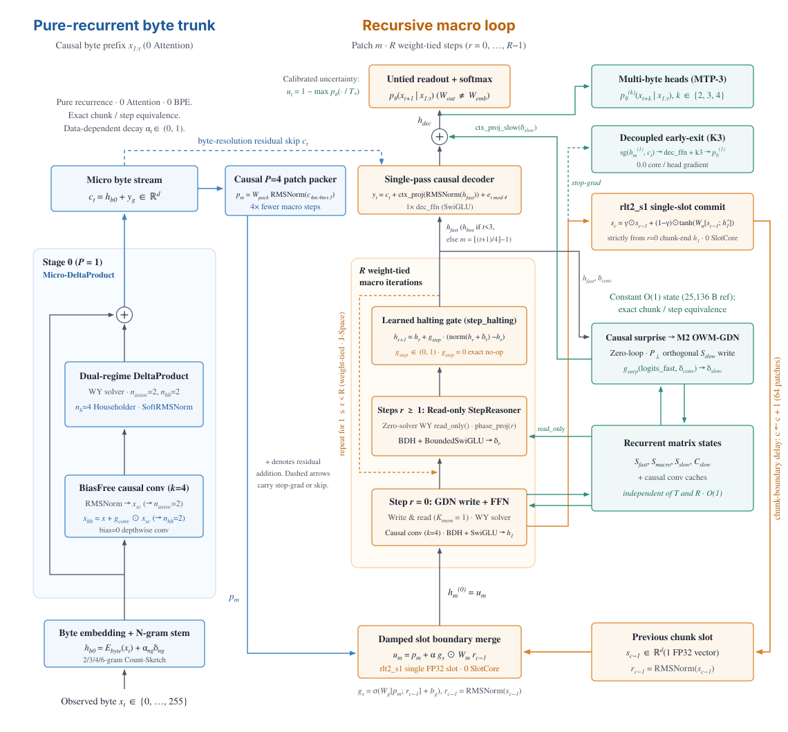
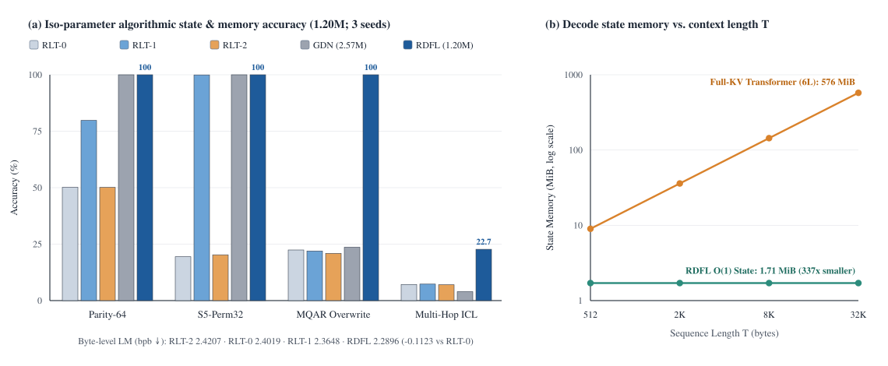
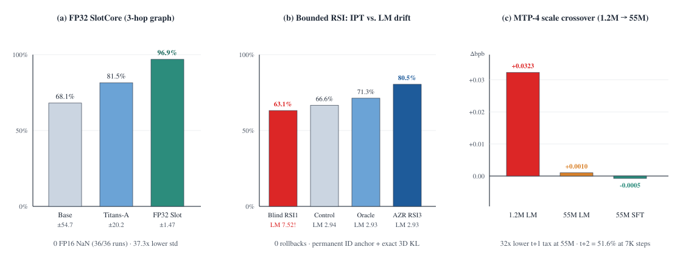

# Recursive Depth Flash Loop (`RDFL`)

**A Byte-Level Constant-Memory Hybrid Sequence Architecture with Weight-Tied Recursive Depth, FP32 Chunk-Boundary Memory, Decoupled Speculative Heads, and Verifier-Gated Self-Improvement**

[](LICENSE)
[](pyproject.toml)
[-1D6B5E.svg)](benchmarks/verify_audited_results.py)

**[English](README.md)** · **[Türkçe](README.tr.md)** · **[Architectural Specification](docs/ARCHITECTURE.md)** · **[Audited Summary JSON](results/audited_summary.json)** · **[Raw Audited JSONs](results/raw/)**

---

## Abstract

Standard autoregressive Transformers maintain a key–value (KV) cache whose memory footprint grows linearly with sequence length $O(T)$, while windowed-attention backbones bound memory at the cost of losing state beyond the attention horizon $M$. Conversely, pure linear-recurrent models struggle with exact associative overwrite and negative-eigenvalue state transitions (e.g., parity and non-abelian permutations).

We introduce **Recursive Depth Flash Loop (`RDFL`)**, a tokenizer-free, byte-level ($x_t \in \{0,\dots,255\}$) hybrid sequence architecture that couples a causal input trunk with a weight-tied recursive refinement core operating over constant-size $O(1)$ recurrent states:

1. **Weight-Tied Recursive Depth (with Optional Input Anchoring):** Iterates a shared recurrent block $R$ times ($h_t^{(r-1)} + \alpha_r e_t + e_r$). Controlled `1.20M` ablations (Section 2) show that `RDFL`'s primary capability gain stems from the synergy of `GatedDeltaNet + BDH + RLT-2` rather than input anchoring alone (unanchored `A6_R4_cipasiz` matches anchored `A6_R4_cipali` on `Multi-Hop ICL` and slightly improves `Byte LM` at marginally higher variance).
2. **Chunk-Parallel Gated DeltaNet with Householder Write Gates:** Combines causal short convolution ($k=4$), multi-scale slow decay ($\alpha_0 \in [0.953, 0.999]$), and Householder-range write gates ($\beta_t = 2\sigma(\cdot) \in (0,2)$), maintaining an exact $O(1)$ matrix state $S_t^{(r)} \in \mathbb{R}^{H \times d_h \times d_h}$ with chunk-parallel WY and single-step equivalence (`4.44e-16` max error in FP64).
3. **Sparse Associative Gating (`BDH`) & Chunk-Boundary `FP32 SlotCore` (Deferred in `v0.3`):** Pairs Gated DeltaNet with a doubly-sparse ReLU interaction gate and a chunk-boundary `float32`-locked memory bank ($S=4$), eliminating mixed-precision NaN crashes (`0/36` NaN at `1.20M`). However, direct `55M` ablation shows zero state-tracking gain (`delta_durum = 0.0`, `delta_bpb = -0.0005 / -0.0003`) alongside symmetric slot collapse (`cos = 0.999982`, Section 3.1), so symmetric `SlotCore` is **deferred / replaced in `v0.3`**.
4. **Zero-Initialization Residual Adaptation & Lossless Auxiliary Heads:** A zero-initialized output projection ($W_{\uparrow}|_0 = 0$) attaches `RDFL` onto pretrained backbones with exact `0.0` step-0 deviation, alongside lossless speculative decoding (`K3` and `MTP-4` in [`rdfl/speculative.py`](rdfl/speculative.py)), zero-parameter calibrated uncertainty (`MSP + T*`), zero-retention ring streaming, and verifier-gated bounded self-improvement (`AZR` RSI).

---

## 1. Architecture



*Figure 1: Computational graph of `RDFL` (bottom-to-top). Blue denotes the causal input trunk and narrow projection; amber denotes the weight-tied recursive depth loop and chunk-boundary `FP32 SlotCore` feedback; teal denotes the constant-size $O(1)$ Gated DeltaNet matrix states and decoupled auxiliary prediction heads (`K3`, `MTP-4`). Full equations and exact module distinctions (`RDFLModel` vs. `ZeroDiffRDFLAdapter`) are provided in [docs/ARCHITECTURE.md](docs/ARCHITECTURE.md).*

---

## 2. Iso-Parameter `1.20M` Benchmarks (`204` Controlled Runs)

All `1.20M` architectural comparisons were executed across 3 independent random seeds and verified against raw JSON artifacts in [`results/raw/`](results/raw/) (frozen code hash `ab9e7db6220038a6`; `0` NaN across all `186` core and architectural ablation runs; the `2` FP16 NaN runs in unguarded FP16 `A6_SLOT4_MESAJLI` on `S5-Perm32` directly motivated `FP32 SlotCore` in Section 3).



All 8 controlled arms (`mean ± sample std` across 3 seeds, verified programmatically from [`results/raw/ablasyon_sonuclari.json`](results/raw/ablasyon_sonuclari.json); algorithmic columns report the harder tail / overwrite / 3-hop diagnostic metrics `kuyruk_48_63_acc`, `kuyruk_24_31_acc`, `uzerine_yazilan_acc`, `3hop_acc`):

| Arm ID | Model Family | Params | `Parity-64` tail (%) | `S5-Perm32` tail (%) | `MQAR Overwrite` (%) | `Multi-Hop ICL` 3-hop (%) | Byte LM (`bpb` ↓) |
| :--- | :--- | :---: | :---: | :---: | :---: | :---: | :---: |
| `A0` | `RLT-0` (Feedback-Off) | `1.20M` | `50.18 ± 0.37` | `19.45 ± 0.65` | `22.40 ± 1.28` | `7.13 ± 0.88` | `2.4019 ± 0.0065` |
| `A1` | `RLT-1` (Token-Step Feedback) | `1.20M` | `79.78 ± 26.25` | `99.93 ± 0.12` | `21.96 ± 1.32` | `7.32 ± 0.49` | `2.3648 ± 0.0174` |
| `A2` | `RLT-2` (Chunk Boundary) | `1.20M` | `50.15 ± 0.43` | `20.27 ± 1.86` | `20.92 ± 1.31` | `7.03 ± 0.29` | `2.4207 ± 0.0217` |
| `A3` | `Flash Hebbian` (Raw) | `1.20M` | `64.68 ± 23.05` | `92.75 ± 3.73` | `3.21 ± 0.48` | `5.63 ± 2.48` | `2.3504 ± 0.0028` |
| `A4` | `GatedDeltaNet` (Iso-Param) | `1.20M` | `100.00 ± 0.00` | `73.13 ± 3.54` | `19.27 ± 7.73` | `6.12 ± 3.03` | `2.2786 ± 0.0050` |
| `A4B` | `GatedDeltaNet` (Iso-FLOP) | `2.57M` | `100.00 ± 0.00` | `95.17 ± 3.93` | `23.63 ± 1.31` | `3.97 ± 0.50` | **`2.1893 ± 0.0064`** |
| `A5` | `BDH-CQ Loop` | `1.20M` | `49.88 ± 0.40` | `72.09 ± 5.39` | `3.36 ± 0.23` | `3.29 ± 0.39` | `2.4676 ± 0.0041` |
| **`A6`** | **`RDFL` (`Delta+BDH+RLT2`)** | **`1.20M`** | **`100.00 ± 0.00`** | **`100.00 ± 0.00`** | **`100.00 ± 0.00`** | **`22.72 ± 1.30`** | `2.2896 ± 0.0060` |

- **Multi-Hop ICL Degree-Filtering Caveat (`KPN-Y01`):** On this synthetic `Multi-Hop ICL` split, `RDFL`'s `22.72 ± 1.30%` 3-hop accuracy outperforms `A4B` (`3.97%`, `5.7×`) and `A0` (`7.13%`), **but lies within the structural degree-filtering ceiling (`1/4 = 25.0%` / `1/8 = 12.5%`, combined `18.75%`)** — evidencing in-context structural node-role tracking rather than unbounded multi-hop graph traversal.
- **State Memory Complexity (`L=6, d=768, H=8`, `d_h=96`):** At measured context lengths $T \in \{512,\, 4{,}096,\, 32{,}768\}$, FP16 Full-KV Transformer decode cache scales linearly as `9.0 / 72.0 / 576.0 MiB`, whereas `GatedDeltaNet` maintains a constant **`1.7139 MiB`** (`1.71 MiB` measured in [`results/raw/gpu_profil_55m.json`](results/raw/gpu_profil_55m.json)) — an exact **`336.1×`** reduction at $T = 32{,}768$ (reproducible on CPU via `python benchmarks/profile_decode_memory.py`). At `55M` training context $T = 8{,}192$, `RLT-2` OOMs above the `3,072 MiB` ceiling while `RDFL (R=2)` trains in `1,877.4 MiB`.
- **Structural & Input-Anchoring Ablations (`dongu_cipa_rlt2_ablasyonu`):**
  - *Chunk-Boundary Feedback (`RLT-2`):* Removing boundary feedback (`A6_R4_rlt2siz`) drops `Multi-Hop ICL` 3-hop accuracy from `22.72 ± 1.30%` to `10.32 ± 11.20%` (`-12.40 pp`, `8.6×` higher std), while slightly lowering `Byte LM` (`2.2790` vs `2.2896 bpb`).
  - *Loop Depth (`R`):* `A6_R2_cipali` matches `A6_R4_cipali` (`23.28 ± 0.92%`, `2.2903 ± 0.0019 bpb`) at `1.8×` higher throughput (`34.43` vs `19.00 KB/s`), whereas `A6_R1_cipali` degrades to `18.00 ± 8.27%` (`2.3044 bpb`).
  - *Input Anchoring (`cipali` vs. `cipasiz` — Honest Null Finding):* Unanchored `A6_R4_cipasiz` achieves equivalent `Multi-Hop ICL` (`22.69 ± 1.76%` vs `22.72 ± 1.30%`) and slightly better `Byte LM` (`2.2843 ± 0.0065` vs `2.2896 ± 0.0060 bpb`) than anchored `A6_R4_cipali`; similarly, `A5_R4_cipasiz` outperforms `A5_R4_cipali` on both (`3.71 ± 0.74%` vs `3.29 ± 0.39%`; `2.4379 ± 0.0145` vs `2.4676 ± 0.0041 bpb`). `RDFL`'s core advantage therefore derives from the **`GatedDeltaNet + BDH + RLT-2`** interaction rather than input anchoring alone.

---

## 3. Audited Self-Capabilities (`ÖY-1 .. ÖY-10` Full Scope Transparency)

`ÖY-1 .. ÖY-8` were evaluated under a pre-registered protocol on unseen seeds `(42, 137, 2026)` strictly disjoint from calibration seed `401` (frozen code hash `c8c2744cd90baca1`; `0` FP16 NaN; peak `1,705.7 MiB` VRAM; raw JSONs in [`results/raw/`](results/raw/)). `ÖY-9` and `ÖY-10` statuses are reported transparently below so all 10 program items are accounted for without overclaiming.



| ID & Mechanism | Status / Verdict | Audited Empirical Findings (Verified from `results/raw/*.json`) |
| :--- | :---: | :--- |
| **`ÖY-1/1B`: `K3` Decoupled Early-Exit & Speculative Decode** | **Adopt** | Detached `R=1` projection improves `R=1` LM by `-0.3899 bpb` (`2.8886 -> 2.4987`) at `+0.0041 bpb` `R=4` tax. Parallel verification yields **`0` byte mismatch** across `288/288` prompts and `1.48×–1.54×` rollback-adjusted FLOP speedup (`1.09×` `K3/K2`, `0.991×` `K3/K4`, `1.28×` `K1/K4` eager wall-clock). |
| **`ÖY-2`: Stateful Adaptive Depth** | **Conditional** | Lossy early exit saves `25.69%` FLOPs at `+0.0444 bpb` / `-0.94 pp` on `byte_lm` (`chunk B=32`; byte-step: `30.57%` FLOPs at `+0.1234 bpb`) and `36.38%` FLOPs at `+0.0662 bpb` / `+0.23 pp` on `graf_izli`. Superseded in deployment by lossless `K3` speculative decode (`0` quality loss). |
| **`ÖY-3`: Calibrated `MSP + T*` Uncertainty** | **Adopt** | Zero extra parameters: `1.2M` `AUROC = 0.8424`, `ECE15 = 0.0116`, `+20.13 pp` accuracy at `40%` abstention (`52.68% -> 72.81%`), `8.32×` lower graph ECE; at `55M`, **`AUROC = 0.8994 / 0.9041`** with `74.65% -> 95.35%` SFT byte accuracy at `40%` abstention. |
| **`ÖY-4`: `MTP-4` Multi-Byte Lookahead** | **Adopt (`55M+`)** | Sharp **`46×` scale crossover**: `+0.0323 bpb` LM capacity tax (`+0.0272 bpb` on `rsi_zincir_L34`) at `1.20M` diminishes **`32×`** to `+0.0010 bpb` LM (`-0.0005 bpb` SFT) under full `55M` weight propagation (Section 4). Before MTP training (step 0), untrained heads slow speculative wall-clock (`0.501×`). |
| **`ÖY-5`: Prompt Self-Correction & MLP Verifier** | **Reject** | Under symmetric `T = 0.0` evaluation, prompt revision corrupted equal-step `D0` drafts (`87.37% -> 48.44% / 49.22%`). Zero-parameter sequence **`log p` (`AUROC = 0.9513`)** decisively outperformed a 25K-parameter MLP verifier (`0.5867`). |
| **`ÖY-6`: `FP32 SlotCore` Chunk-Boundary Memory** | **Deferred / Replaced in `v0.3`** | At `1.20M`, `0/36` NaN and 3-hop `graf_izli` `68.09 ± 54.73% -> 96.89 ± 1.47%` (`37.3×` lower std), `MQAR 99.88%`, at `+0.0173 bpb` LM tax (`ffn 512->128`). **At `55M` (`1.33M` params):** `slot_on == slot_off` on state tracking (`59.38%` vs `59.38%`, `delta_durum = 0.0`), `delta_bpb = -0.0005` (Ana) / `-0.0003` (RSI), and all 4 slots collapse to **`cos = 0.999982`** (Section 3.1). `BDH` beats `BDH-less` on `3/3` seeds (`-0.0071 bpb`). |
| **`ÖY-7`: Verifier-Gated Bounded `AZR` RSI** | **Adopt (Bounded + SFT Guard)** | Over `75` `1.20M` generations, blind RSI collapsed (`LM: 7.5162 bpb`, `ID: 63.54%`) while bounded `AZR` achieved best `LM = 2.9301 bpb`, `0` rollbacks, `ID = 98.44%`, `IPT = 80.45%`. At `55M` (`8` gens, `0` rollbacks), RSI hit a hard `L=4 <-> L=5` wall (`96/96` vs `0/96` accepted) and degraded SFT generation (`completion 0.78 -> 0.58`, `repetition 0.40 -> 0.60`) due to missing SFT/`EOT` replay under entropy bonus (Section 4). |
| **`ÖY-8`: Zero-Retention Ring Stream** | **Adopt** | Receipt-locked streaming ring buffer enforces `0.0 MiB` residual disk (`32.0 MiB` stream, `4.0 MiB` peak disk, `0.0 MiB` VRAM). |
| **`ÖY-9`: Online Weight Self-Editing (`SEAL` / `E-SELF`)** | **Deferred (Out of Scope)** | Evaluated via literature review only; deferred from the `1.20M` / `55M` V2 experimental matrix (no standalone experiment claimed). |
| **`ÖY-10`: `ToolRunner` (`<calc>` / `<check>` / `<note>`)** | **Adopt (Template Scope)** | Harness code resides in the external training repository. Across `n=24` arithmetic prompts: pre-training `55M` baseline `0.0%` -> post-training `55M` Ana (`21K`), RSI (`8`-gen), and RDFL-off `G_BASE_ONLY` (`1.5K`) all reach **`100.0%` call rate / `100.0%` accuracy** (`0.0%` without tool), whereas turning `RDFL` off on co-adapted `en_iyi.pt` (`21K`) drops accuracy to `54.17%`. |

### 3.1 Seed-Level Breakdown (`graf_izli`), Iso-Param `Byte LM` Trade-Off & Mechanistic Honesty Finding

Per-seed `graf_izli` accuracy and `Byte LM` (`bpb` ↓) across unseen seeds `(42, 137, 2026)` from [`results/raw/oy5_6_sonuclari.json`](results/raw/oy5_6_sonuclari.json):

| Arm (`ÖY-6`, `1.20M`) | `graf_izli` Seeds `(42 / 137 / 2026)` | `graf_izli` Mean ± Std | `Byte LM` (`bpb` ↓) |
| :--- | :---: | :---: | :---: |
| `OY6_A6_TABAN` (`ffn=512`, Single-Vector) | `99.60% / 99.77% / 4.89%` | `68.09 ± 54.73%` | `2.3646 ± 0.0017` |
| `OY6_A6_BDHSIZ` (`ffn=896`, BDH-Less) | `5.97% / 99.34% / 99.92%` | `68.41 ± 54.08%` | `2.3717 ± 0.0030` |
| `OY6_A6_SASKINLIK_GDN` (`Titans-A`) | `99.61% / 59.72% / 85.06%` | `81.46 ± 20.19%` | **`2.3641 ± 0.0015`** |
| **`OY6_A6_SLOT4_FP32` (`ffn=128`, `FP32 SlotCore`)** | **`95.30% / 98.19% / 97.17%`** | **`96.89 ± 1.47%`** | `2.3819 ± 0.0055` (`+0.0173`) |

- **Iso-Parameter `Byte LM` Trade-Off (`+0.0173 bpb`):** Keeping `OY6_A6_SLOT4_FP32` iso-parameter at `1.20M` required shrinking its FFN from `512` to `128`, which caused a `+0.0173 bpb` regression on `Byte LM` (`2.3819` vs `2.3646`, worst of the 4 `ÖY-6` arms) despite dramatically stabilizing 3-hop graph tracking (`37.3×` lower std). At `55M`, `FP32 SlotCore` is attached externally onto the unshrunk `ffn=3072` backbone to avoid cannibalizing FFN width.
- **Mechanistic Honesty Finding — Symmetric Collapse & Zero `55M` Gain of `FP32 SlotCore` ([`results/raw/slotcore_55m_cosine_probe.json`](results/raw/slotcore_55m_cosine_probe.json), [`ana_55m_degerlendirme.json`](results/raw/ana_55m_degerlendirme.json)):** Direct CPU probing of the trained `55M` checkpoint (step `21,000`, `16` real text chunks / `1,024` bytes from `mix/validation.bin`) shows that while `init_slots` start at pairwise cosine **`0.5017–0.7512`** (`mean = 0.6446`, `norm = 0.6941`), after `16` chunks all $S=4$ slots collapse to pairwise cosine **`0.999982`** (`min = 0.999959`, `max = 0.999999`) with mean L2 norm **`664.5`** (reproducible on CPU via `python benchmarks/run_1_2m_suite.py --smoke --measure-slot-cosine`). Moreover, full `55M` ablation confirms **`delta_durum = 0.0`** (`59.38%` ON vs `59.38%` OFF) and negligible `delta_bpb_2048 = -0.0005` (Ana) / `-0.0003` (RSI). Consequently, symmetric `FP32 SlotCore` is **deferred / replaced in `v0.3`** by damped 1-slot `Fp32RLT2Boundary` (`rlt2_s1`, with competitive multi-slot `SlotAttention` reserved for future `v0.4+` work).

---

## 4. Completed `55M` Adaptation, `G_BASE_ONLY` Causal Control & `ÖY-7` RSI (`Diogenes-RDFL-55M`)

> **Audit Status:** All `55M` final artifacts below are verified cell-by-cell (`698/698`, `0` mismatches) against [`results/raw/`](results/raw/) (`kod_sha256 = 3c1a59a1dd2bb0f7`) and are **pending independent zero-context Carbon closure audit**.

We attach `RDFL` (`d = 384`, `R = 2`, `2.81M`), `FP32 SlotCore` (`S = 4`, `1.33M`), `K3` (`0.74M`), and `MTP-4` (`2.36M`) (`7.24M` total adapter parameters) onto a pretrained `55.08M` byte-level windowed-attention backbone (`M = 512`, `d_base = 1536`, `ffn = 3072` preserved unshrunk; `62.32M` grand total) paired with an episodic content-memory reader (`cmem`, `0.86M`).

- **Gate-1 Verification ([`dogrulama_kapisi_55m.json`](results/raw/dogrulama_kapisi_55m.json)):** Exact step-0 deviation `0.0` across logits, normalized hidden state, and `cmem` outputs; strict causality error `0.0`; `forward() == step()` parity `1.335e-05` (FP32); `0/12` smoke NaNs (`3,438.7 MiB` peak VRAM).
- **Controlled `1,500`-Step `G_BASE_ONLY` vs. `G0` vs. `G1` & `42K` Trajectory (`fast-val` protocol\*, [`g_base_only_kontrol.json`](results/raw/g_base_only_kontrol.json), [`saat1_mtp_kapisi.json`](results/raw/saat1_mtp_kapisi.json), [`ana_egitim_ozet.json`](results/raw/ana_egitim_ozet.json)):**

| Model State (`fast-val` protocol\*) | `LM (T=512)` ↓ | `K3 R=1 (T=512)` ↓ | `LM (T=2048)` ↓ | `SFT Val` ↓ | Composite ↓ | `MTP t+2 / t+3 / t+4` ↑ | Time / VRAM |
| :--- | :---: | :---: | :---: | :---: | :---: | :---: | :---: |
| Pretrained `55M` Base (Step 0) | `1.1268` | `1.1268` | `1.0419` | `1.2416` | `1.1200` | `10.1% / 9.2% / 10.7%` | — / `968.9 MiB` |
| **`G_BASE_ONLY` (`1.5K`, `RDFL` OFF, `delta_z=0`)** | **`1.1231`** | **`1.1231`** | `1.0346` | **`1.2410`** | **`1.1157`** | `10.1% / 9.3% / 10.7%` | **`437.9s` / `2,770.6 MiB`** |
| `G0` ($\lambda_{\text{MTP}} = 0$, `1.5K`, `RDFL` ON) | `1.1232` | `1.1233` | **`1.0344`** | `1.2415` | `1.1158` | `10.2% / 9.3% / 10.7%` | `1,448.9s` / `2,981.9 MiB` |
| `G1` ($\lambda_{\text{MTP}} = 0.15$, `1.5K`, `RDFL` ON) | `1.1242` | `1.1237` | `1.0362` | `1.2410` | `1.1167` | **`34.1% / 24.6% / 21.4%`** | `1,517.0s` / `3,833.9 MiB` |
| Final Best `en_iyi.pt` (`21K`, `RDFL` ON) | `1.1197` | `1.1201` | `1.0254` | `1.2485` | `1.1124` | `54.9% / 42.9% / 35.4%` | — / `3,442.7 MiB` |
| Final `en_iyi.pt` (`21K`, **`RDFL` OFF, `delta_z=0`**) | `1.1197` | `1.1197` | `1.0260` | **`1.2412`** | **`1.1112`** | `43.5% / 31.7% / 27.2%` | — |
| Final `son.pt` (`42K`, `RDFL` ON) | **`1.1169`** | **`1.1185`** | **`1.0231`** | `1.2998` | `1.1207` | **`55.9% / 44.0% / 35.8%`** | `41,894.8s` / `3,443.5 MiB` |

- **Full-Battery Evaluation & `en_iyi.pt` (`21K`) `RDFL ON vs. OFF` Ablation (`full-val` protocol: `8` batches, `400` SFT lines, `50` generations, `128` real-document QA, `24` ToolRunner prompts; [`taban_55m_degerlendirme.json`](results/raw/taban_55m_degerlendirme.json), [`ana_55m_degerlendirme.json`](results/raw/ana_55m_degerlendirme.json), [`rsi_55m_degerlendirme.json`](results/raw/rsi_55m_degerlendirme.json), [`g_base_only_kontrol.json`](results/raw/g_base_only_kontrol.json)):**

| Full-Battery Metric | Base (`0`) | `G_BASE_ONLY` (`1.5K`) | `Ana 21K` (`RDFL` ON) | `Ana 21K` (`RDFL` OFF) | `Δ(ON - OFF)` | `RSI` (`8` Gens) |
| :--- | :---: | :---: | :---: | :---: | :---: | :---: |
| `mix_val_512_r2_bpb` ↓ | `1.1549` | `1.1524` | `1.1467` | `1.1477` | `-0.0010` | **`1.1452`** |
| `mix_val_2048_r2_bpb` ↓ | `1.0718` | `1.0645` | `1.0566` | `1.0568` | `-0.0002` | **`1.0547`** |
| `web_val_2048_r2_bpb` ↓ | `1.4067` | `1.3949` | `1.3878` | `1.3878` | `0.0000` | **`1.3859`** |
| `sft_val_bits` (`400` lines) ↓ | `1.2567` | `1.2550` | `1.2630` | `1.2564` | `+0.0066` | **`1.2543`** |
| `sft.completion_rate` (`50`) ↑ | `0.7200` | `0.7400` | **`0.7800`** | `0.3400` | `+0.4400` | `0.5800` |
| `sft.repetition_rate` (`50`) ↓ | `0.4200` | `0.4800` | **`0.4000`** | `0.7800` | `-0.3800` | `0.6000` |
| `real_qa_d4000.qa.gen_on_exact` ↑ | `0.0703` | `0.0625` | **`0.1328`** | `0.1094` | `+0.0234` | `0.1250` |
| `real_qa_d4000.qa.on_bits` ↓ | `1.2049` | `1.1947` | `1.1366` | `1.1532` | `-0.0166` | **`1.1350`** |
| State Tracking (`32` prompts) ↑ | `0.0000` | `0.2500` | **`0.5938`** | **`0.5938`** | **`0.0000`** | **`0.5938`** |
| `ÖY-10 ToolRunner` (`24` prompts) ↑ | `0.0000` | **`1.0000`** | **`1.0000`** | `0.5417` | `+0.4583` | **`1.0000`** |
| `cmem chain3_held` / `natural_bits_on` | `0.8750` / `1.3392` | — | `0.9062` / `1.3274` | — | — | **`0.9375` / `1.3265`** |
| Speculative `K3` / `MTP-4` wall (`0` diff) | `1.060×` / `0.501×` | — | `1.042×` / `0.968×` | — | — | `1.007×` / `0.865×` |

> **Honest Causal Takeaways (`G_BASE_ONLY`, `RDFL ON/OFF` & `ÖY-7` `55M` RSI):**
> 1. **`G_BASE_ONLY` (`1.5K`):** Training only the `55.08M` `core` + `0.86M` `reader` (`maks|delta_z| == 0.0` verified at steps `0` and `1,500`) runs **`3.3×` faster** (`437.9s` vs `1,448.9s`), matches/beats `G0` and `G1` on composite `bpb` (`1.1157` vs `1.1158 / 1.1167`), and already achieves `100%` `<calc>` `ToolRunner` (`G1` only adds `MTP-4` lookahead accuracy).
> 2. **`en_iyi.pt` (`21K`) `RDFL ON vs. OFF`:** Although `RDFL` produces a strong active residual (`rms(delta_r2) / rms(z) = 14.1%`, `max|delta_r2| = 22.39`), zeroing `delta_z` yields negligible pure LM `bpb` change (`-0.0010 / -0.0002 / 0.0000`), lower teacher-forced `sft_val_bits` (`1.2564` vs `1.2630`), and `0.0000` change in state tracking (`59.38%`), while severely degrading co-adapted generative outputs (`completion 0.78 -> 0.34`, `repetition 0.40 -> 0.78`, `OY-10 1.00 -> 0.5417`, `real_qa 13.28% -> 10.94%`). This confirms `core + RDFL` co-adaptation rather than a standalone pure-LM `bpb` advantage for the hybrid side-branch.
> 3. **`ÖY-7` `8`-Gen `55M` RSI ([`oy7_rsi_55m.json`](results/raw/oy7_rsi_55m.json)):** `0` rollbacks (`745.9s`, `2,262.2 MiB`), `lm_bits_512: 1.1197 -> 1.1176`, `cmem chain3_held: 0.9062 -> 0.9375`, **but** hit a hard `L=4 <-> L=5` wall (`96/96` accepted on `L=4`, `0/96` on `L=5`, `ara_pass1 = 0.0`, `ipt_pass1 = 0.50`) and degraded SFT generation (`completion 0.78 -> 0.58`, `repetition 0.40 -> 0.60`) because the entropy bonus lacked an SFT/`EOT` replay guard.

---

## 5. `RDFL v0.3` Hardening (`K1–K5`), Serving Wall (`H5`), & Mechanistic X-Ray

All `v0.3` kernel fixes (`13/13` CPU unit tests in [`tests/test_rdfl.py`](tests/test_rdfl.py)), serving benchmarks, and mechanistic probes are archived in [`results/raw/`](results/raw/) (`deney_a_k1_k5.json`, `h5_memory_latency_and_serving.json`, `math_xray_master_synthesis.json`, `p3_long_v03.json`, `p2_long_v03.json`; status: *Pending Carbon audit*):

1. **`K1–K5` Core Hardening ([`results/raw/deney_a_k1_k5.json`](results/raw/deney_a_k1_k5.json)):**
   - **`K3` (`std=0.02` Weight Initialization):** Eliminates step-0 logit explosion (`d=192: CE 193.82 -> 5.54`, `d=768: 752.45 -> 5.78`), cuts FP16 overflows (`8 -> 0`), and improves 500-step `Byte LM` (`mix_val`) by **`-0.5789 bpb`** (`3.1682 ± 0.0065 -> 2.5893 ± 0.0066`, `p = 8e-5`).
   - **`K5` (`0`-Extra-Pass Snapshot Speculative Decoding):** `forward_with_snapshots()` eliminates rollback recomputation (`0` extra passes, `0` byte mismatch), delivering **`1.68×`** real wall-clock speedup on eager GPU (`K3: 2.349s -> 1.401s`, `59.3%` accept; `MTP-4: 2.349s -> 1.396s`, `21.3%` accept; Triton/Graph trained-checkpoint verification pending).
   - **`K1 / K4 / K2` Scoped Notes:** `K1` (per-head FP32 `o_norm`) is an FP16 safety & head-balance fix (`0` NaN; `+0.0134 bpb`, `p = 0.098`, within noise); `K4` (`mtp_stop_grad=True` + single `final_norm`) removes main-head CE interference (`2.2023 -> 2.0638` at 150 steps); `K2` (`rlt2_s1` 300-step `graf_izli trace=False`) remained at chance (`0.0443`, inconclusive).
2. **`H5` Live GPU Serving Wall & Iso-Param Text-Normalized Memory ([`results/raw/h5_memory_latency_and_serving.json`](results/raw/h5_memory_latency_and_serving.json)):**
   - **Live GPU (`B=8`):** At `T = 65,536`, `RoPE-Transformer` hits **OOM** (`2,415.8 MiB` already at `T = 32,768`), whereas **Pure `RDFL`** stays $O(1)$ at **`153.77 MiB`** (`151.77 MiB` at `T = 32,768`).
   - **Iso-Parameter Text-Byte Comparison (`1B` & `55M` at `1M` Text Bytes):** Against `GQA-8 FP8` (`4B/tok`), `1B` Pure `RDFL` (`10.55 MiB`) is **`291.3×`** smaller (`3,072 MiB` KV, crossover `3,600 B`), and `55M` Pure `RDFL` (`2.11 MiB`) is **`303.4×`** smaller (`640 MiB` KV, crossover `3,456 B`).
3. **Mechanistic X-Ray & Falsification Discipline ([`results/raw/math_xray_master_synthesis.json`](results/raw/math_xray_master_synthesis.json), [`p3_long_v03.json`](results/raw/p3_long_v03.json), [`p2_long_v03.json`](results/raw/p2_long_v03.json)):**
   - **Genuine Recurrent Memory (`mqar_k8` & `byte_lm`):** Zeroing $S_t=0$ collapses `mqar_k8` from **`98.63% -> 6.25%`** (chance); `byte_lm` exhibits **`BDH L0 = 90.5%`** sparsity (`r=0`), **`1.69×`** concentration on post-whitespace decision bytes (`r=1`), **`P(beta > 1.0) = 32.2% / 33.4%`** active Householder regime, and **`0`** rank collapse up to `T = 2048` (retracted `running=True` `S5`/`Parity` shortcut X-rays are excluded).
   - **5-Seed `1000`-Step Architectural Laws (`P3_long` & `P2_long`):** `P3` (`unit_rms/safe_rms/ency_init`) was falsified (`p = 0.423 / 0.910`), while iso-param `use_bdh=False` (`SwiGLU`) outperformed `BDH ReLU*ReLU` on `5/5` seeds (**`-0.0121 bpb`** `mix_val`, **`-0.0150 bpb`** `web_val`, `p = 0.0018`), quantifying `BDH`'s interpretability sparsity tax. `P2` (`conv.bias=0`) was also falsified: removing `short_conv.conv.bias` raised `erank` (`8.26 -> 12.19`) but degraded `Byte LM` (**`+0.0085 bpb`**, `p = 0.0048`), proving `conv.bias` acts as a useful linear attention-sink channel.

---

## 6. Methodological Limitations

1. **Pure-PyTorch Reference Kernel & Speculative Overhead:** Pure-PyTorch chunk-parallel WY + SDPA hits a kernel-launch ceiling on consumer GPUs: at `55M`, lossless `K3` (`99.0–100%` accept) yields only `1.042×` (`1.007×` RSI) and `MTP-4` (`42.8%` accept) yields `0.968×` (`0.865×` RSI). From-scratch scaling requires a fused Triton / Flash Linear Attention (`fla`) `GatedDeltaNet` kernel.
2. **Hybrid `55M` Side-Branch vs. Pure `RDFL`:** Our `G_BASE_ONLY` (`1.5K`) and `en_iyi.pt` `RDFL ON/OFF` (`21K`) controls show that attaching `RDFL` as a warm side-branch onto a `55M` windowed-attention backbone yields negligible pure-LM `bpb` gain (`-0.0010 / -0.0002 / 0.0000`) and `0.0` state-tracking gain; evaluating `RDFL` at scale therefore requires from-scratch **Pure `RDFL`** pretraining against iso-FLOP baselines.
3. **`SlotCore` Collapse (`Deferred / Replaced in v0.3`) & `Multi-Hop ICL` Ceiling (`KPN-Y01`):** Symmetric `FP32 SlotCore` collapses to `cos = 0.999982` (`norm = 664.5`) with `0.0` `55M` state-tracking gain and is deferred for competitive `v0.3` `SlotAttention`. At `1.20M`, `Multi-Hop ICL` `22.72%` lies within the `1/4 = 25.0%` (`1/8 = 12.5%`) degree-filtering ceiling (`KPN-Y01`), and input anchoring showed a null effect (`A6_R4_cipasiz` matched `A6_R4_cipali`).
4. **OOD Extrapolation & RSI SFT Guard:** Both `1.20M` (`OOD-Far L=7,8 = 0.0%`) and `55M` RSI (`L=4 <-> L=5` wall, `0/96` accepted on `L=5`) show that verifier-gated RSI cannot bootstrap past a zero-acceptance length wall without curriculum bridges, and requires explicit SFT/`EOT` replay to prevent completion/repetition drift.
5. **Hardware & Verification Protocol:** All experiments ran on a single consumer 8 GiB Turing GPU with strict train/validation/test separation; **`782/782`** cells in `results/audited_summary.json` are programmatically verified against `results/raw/*.json` in CI (`55M` final and `v0.3` artifacts are pending independent Carbon closure audit).

---

## 7. Reference Implementation & One-Command Reproducibility (CPU)

```bash
git clone https://github.com/berkmec/Recursive-Depth-Flash-Loop.git
cd Recursive-Depth-Flash-Loop
pip install -e ".[dev]"

# 1. Mathematical invariant unit tests (13/13: chunk==step FP64, causality, zero-diff, K1-K5, FP32 SlotCore/RLT2 lock, AUROC ties)
python -m unittest discover -s tests -v

# 2. Programmatically verify all 782 audited cells in results/audited_summary.json against results/raw/*.json
python benchmarks/verify_audited_results.py

# 3. Measure O(1) decode state vs. FP16 full-KV cache directly from CPU PyTorch tensors
python benchmarks/profile_decode_memory.py

# 4. Run 1.20M algorithmic suite (4 tasks x 4 arms) + SlotCore pairwise cosine diagnostic (<10s on CPU)
python benchmarks/run_1_2m_suite.py --smoke

# 5. Regenerate & XML-validate all vector figures directly from audited JSONs
python scripts/build_diagrams.py
```

```python
import torch
from rdfl import (
    RDFLConfig,
    RDFLModel,
    ZeroDiffRDFLAdapter,
    greedy_decode,
    msp_uncertainty,
    speculative_decode_k3,
    speculative_decode_mtp4,
)

cfg = RDFLConfig(d_model=192, num_heads=6, ffn_dim=512, num_loops=2, num_slots=4)
model = RDFLModel(cfg).double().eval()
prompt = torch.randint(0, 256, (1, 32))

# Lossless (0-byte-mismatch) speculative decoding with K3 and MTP-4
ref = greedy_decode(model, prompt, max_new_tokens=16)
res_k3 = speculative_decode_k3(model, prompt, max_new_tokens=16, draft_k=2)
res_mtp = speculative_decode_mtp4(model, prompt, max_new_tokens=16)
assert (res_k3.tokens == ref).all() and (res_mtp.tokens == ref).all()

# Zero-parameter MSP uncertainty & zero-diff pretrained backbone adapter
logits, _, _, _ = model.forward_stateful(prompt)
conf, unc = msp_uncertainty(logits)
adapter = ZeroDiffRDFLAdapter(d_base=1536, d_narrow=384, num_heads=6, num_loops=2)
z_base = torch.randn(1, 32, 1536)
assert (adapter(z_base) - z_base).abs().max().item() == 0.0
```

---

## References

1. **Gated DeltaNet:** Songlin Yang, Jan Kautz, and Ali Hatamizadeh. *Gated Delta Networks: Improving Mamba2 with Delta Rule.* ICLR 2025. [`arXiv:2412.06464`](https://arxiv.org/abs/2412.06464)
2. **RLT:** Yifan Zhang et al. *Recurrent Looped Transformer.* 2026. [`arXiv:2610.07591`](https://arxiv.org/abs/2610.07591)
3. **BDH & BDH-CQ:** Adrian Kosowski, Przemysław Uznański, Jan Chorowski, Zuzanna Stamirowska, and Michał Bartoszkiewicz. *The Dragon Hatchling: The Missing Link between the Transformer and Models of the Brain.* 2025. [`arXiv:2509.26507`](https://arxiv.org/abs/2509.26507) · Björn Engdahl, Adrian Kosowski, Jan Chorowski, Zuzanna Stamirowska, Przemysław Uznański, Junlin Jiang, Rohan Phadke, Remigiusz Kinas, and Richard Zhong. *BDH-CQ: In-Context Learning with Recurrent Latent Reasoning.* 2026. [`arXiv:2608.09888`](https://arxiv.org/abs/2608.09888)
4. **Slot Attention:** Francesco Locatello, Dirk Weissenborn, Thomas Unterthiner, Aravindh Mahendran, Georg Heigold, Jakob Uszkoreit, Alexey Dosovitskiy, and Thomas Kipf. *Object-Centric Learning with Slot Attention.* NeurIPS 2020. [`arXiv:2006.15055`](https://arxiv.org/abs/2006.15055)
5. **Medusa:** Tianle Cai, Yuhong Li, Zhengyang Geng, Hongwu Peng, Jason D. Lee, Deming Chen, and Tri Dao. *Medusa: Simple LLM Inference Acceleration Framework with Multiple Decoding Heads.* ICML 2024. [`arXiv:2401.10774`](https://arxiv.org/abs/2401.10774)
6. **MTP:** Fabian Gloeckle, Badr Youbi Idrissi, Baptiste Rozière, David Lopez-Paz, and Gabriel Synnaeve. *Better & Faster Large Language Models via Multi-token Prediction.* ICML 2024. [`arXiv:2404.19737`](https://arxiv.org/abs/2404.19737)
7. **AZR:** Andrew Zhao, Yiran Wu, Yang Yue, Tong Wu, Quentin Xu, Matthieu Lin, Shenzhi Wang, Qingyun Wu, Zilong Zheng, and Gao Huang. *Absolute Zero: Reinforced Self-play Reasoning with Zero Data.* 2025. [`arXiv:2505.03335`](https://arxiv.org/abs/2505.03335)
8. **Dr. GRPO:** Zichen Liu, Changyu Chen, Wenjun Li, Penghui Qi, Tianyu Pang, Chao Du, Wee Sun Lee, and Min Lin. *Understanding R1-Zero-Like Training: A Critical Perspective.* 2025. [`arXiv:2503.20783`](https://arxiv.org/abs/2503.20783)
9. **Titans:** Ali Behrouz, Peilin Zhong, and Vahab Mirrokni. *Titans: Learning to Memorize at Test Time.* 2025. [`arXiv:2501.00663`](https://arxiv.org/abs/2501.00663)
10. **SEAL:** Adam Zweiger, Jyothish Pari, Han Guo, Ekin Akyürek, Yoon Kim, and Pulkit Agrawal. *Self-Adapting Language Models.* 2025. [`arXiv:2506.10943`](https://arxiv.org/abs/2506.10943)
11. **MSP:** Dan Hendrycks and Kevin Gimpel. *A Baseline for Detecting Misclassified and Out-of-Distribution Examples in Neural Networks.* ICLR 2017. [`arXiv:1610.02136`](https://arxiv.org/abs/1610.02136)
12. **Temperature Scaling:** Chuan Guo, Geoff Pleiss, Yu Sun, and Kilian Q. Weinberger. *On Calibration of Modern Neural Networks.* ICML 2017. [`arXiv:1706.04599`](https://arxiv.org/abs/1706.04599)
13. **Sleep Consolidation:** Ali Behrouz et al. *Language Models Need Sleep.* 2026. [`arXiv:2606.03979`](https://arxiv.org/abs/2606.03979)

---

## Citation

```bibtex
@software{berkmec2026rdfl,
  author  = {berkmec},
  title   = {Recursive Depth Flash Loop (RDFL): A Byte-Level Constant-Memory Hybrid Sequence Architecture},
  year    = {2026},
  url     = {https://github.com/berkmec/Recursive-Depth-Flash-Loop}
}
```
