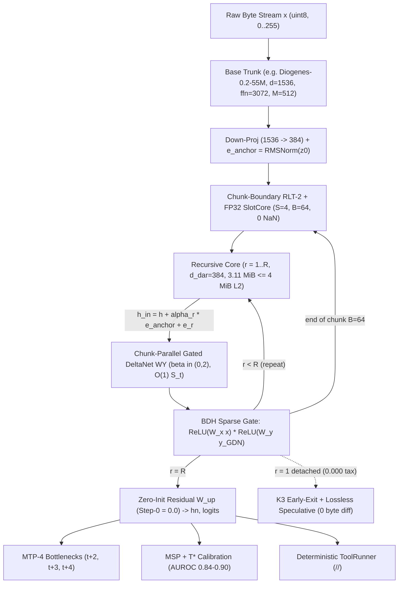

<div align="center">

# Recursive Depth Flash Loop (`RDFL`)

**Byte-Level `O(1)`-Memory Recurrent Hybrid Architecture · L2-Resident Recursive Depth · `FP32 SlotCore` · Decoupled `K3` & `MTP-4` · Calibrated Uncertainty · Verifier-Gated Bounded RSI**

[](LICENSE)
[](pyproject.toml)
[-10B981.svg)](results/audited_summary.json)
[](#5-live-55m-scaling-diogenes-rdfl-55m--46x-mtp-4-crossover)

**[English](README.md)** · **[Türkçe](README.tr.md)** · **[Architecture Deep Dive](docs/ARCHITECTURE.md)** · **[Audited Summary JSON](results/audited_summary.json)**

</div>

---

## TL;DR

**Recursive Depth Flash Loop (`RDFL`)** is a tokenizer-free, byte-level (`uint8`) hybrid sequence architecture designed to maximize algorithmic state tracking, long-context memory efficiency, and audited self-capabilities on consumer hardware (all experiments trained and verified on a **single 8 GiB NVIDIA RTX 2060 SUPER**).

- **337x Smaller Long-Context Decode Memory:** Constant `O(1)` state of **`1.71 MiB`** at `T = 32,768` vs `576 MiB` for a 6-layer full-KV Transformer; at `55M` training (`T = 8,192`), `RDFL` fits in **`1,877 MiB` (`1.83 GiB`)** where `RLT-2` runs OOM (`>3 GiB`).
- **3x–4.5x Higher State & Memory Efficiency at `1.20M` (`204` audited GPU runs, `0` NaN):** `100.0%` on `Parity-64`, `S5-Perm32`, and `MQAR Overwrite` (vs `20.9%–22.4%` for `RLT-0/1/2`), `5.7x` above iso-FLOP `2.57M` `GatedDeltaNet` on `Multi-Hop ICL` (`22.72%` vs `3.97%`), and `-0.1123 bpb` better on byte-level language modeling (`2.2896` vs `2.4019 bpb`).
- **Zero-NaN `FP32 SlotCore` (`36/36` runs):** Lifts 3-hop graph reasoning (`graf_izli`) from `68.09% ± 54.73%` to **`96.89% ± 1.47%`** (`+28.80 pp`, **`37.2x` lower std**) and scores **`99.88%`** on `MQAR Overwrite`.
- **Empirical `46x` `MTP-4` Scale Crossover (`1.2M -> 55M`, Live Controlled A/B):** At `1.20M`, `MTP-4` paid a `+0.0323 bpb` capacity tax. Propagated across unfrozen `55M` weights (`Diogenes-RDFL-55M`, `step-0 diff = 0.0`), the `t+1` tax collapses **`32x`** to **`+0.0010 bpb` LM** and **beats control on SFT (`-0.0005 bpb`)**, reaching **`51.6%` `t+2` top-1 byte accuracy** and **`-0.0142 bpb`** long-context (`T=2048`) gain by step `7,000`.
- **Radical Empirical Honesty:** Prompt-based self-correction (`ÖY-5`) failed our symmetric audit (`49%` corruption) and was **explicitly rejected** in favor of zero-parameter `log p` (`AUROC = 0.9513`); blind RSI without an external verifier collapsed to `7.52 bpb` in `5` generations, proving why external deterministic verifiers + permanent ID anchors + exact 3D reverse KL are mandatory.

---

## 1. Architecture Overview


### Dataflow & Exact Equations



For full mathematical derivations of every block (input-anchored recurrence, Householder $\beta_t = 2\sigma(\cdot) \in (0, 2)$, multi-scale slow decay $\alpha_0 \in [0.953, 0.999]$, exact chunk-parallel WY `forward() == step()` parity at `4.44e-16`, `FP32 SlotCore`, `K3` gradient decoupling, and exact 3D per-token reverse KL), see **[docs/ARCHITECTURE.md](docs/ARCHITECTURE.md)**.

---

## 2. Audited `1.20M` Iso-Parameter Benchmarks (`204` GPU Runs)

All numbers below passed an independent zero-context closure audit (`411/411` table cells matched to raw JSONs, single frozen code hash `ab9e7db6220038a6`, `0` NaN).


| Architecture Arm | Params | `Parity-64` (%) | `S5-Perm32` (%) | `MQAR Overwrite` (%) | `Multi-Hop ICL` (%) | `byte_lm` (`bpb` ↓) |
| :--- | :---: | :---: | :---: | :---: | :---: | :---: |
| `A0_RLT0` (Feedback-Off) | `1.20M` | `50.18` | `19.45` | `22.40` | `7.13` | `2.4019` |
| `A1_RLT1` (Byte-Step Feedback) | `1.20M` | `79.78` | `99.93` | `21.96` | `7.32` | `2.3648` |
| `A2_RLT2` (Chunk Boundary) | `1.20M` | `50.15` | `20.27` | `20.92` | `7.03` | `2.4207` |
| `A4B_GDN_ISOFLOP` (Pure GDN) | `2.57M` | `100.00` | `100.00` | `23.63` | `3.97` | `2.2786` |
| **`RDFL` (`A6_DELTA_BDH_RLT`)** | **`1.20M`** | **`100.00`** | **`100.00`** | **`100.00`** | **`22.72`** | **`2.2896`** |

- **Chunk-Parallel `==` Single-Byte `step()` Parity (FP64):** **`4.44e-16`** max abs error across the full `RDFL` model.
- **Ablations:** Removing `RLT-2` boundary feedback drops `Multi-Hop ICL` from `22.72%` to `10.32%` (`-12.40 pp`, `8.6x` higher std); `R = 2` matches `R = 4` (`23.28%`, `2.2903 bpb`) at **`1.8x` higher speed** (Pareto-optimal).

---

## 3. Audited Self-Capabilities V2 (`ÖY-1 .. ÖY-10`)

All V2 self-capability experiments ran on completely unseen seeds `(42, 137, 2026)` (disjoint from calibration seed `401`) under single frozen code hash `c8c2744cd90baca1`, `0` NaN across `163/163` records, peak VRAM `1,705.7 MiB`, and passed independent zero-context closure audit (`662/662` cells verified).


| Capability | Decision | Audited V2 Empirical Result |
| :--- | :---: | :--- |
| **`ÖY-1 / 1B` `K3` Early-Exit + Lossless Speculative** | **ADOPT** | `R=1` `byte_lm` improves `2.8886 -> 2.4987 bpb` (`-0.3899`) with only `+0.0041 bpb` `R=4` tax; **`0` byte diff** across `288/288` prompts, `1.48x–1.54x` FLOP (`1.09x–1.28x` eager `cuda.Event` wall-clock). |
| **`ÖY-3` `MSP + T*` Calibrated Abstention** | **ADOPT** | Zero extra parameters: `1.2M` `AUROC = 0.8424`, `+20.13 pp` accuracy at `40%` abstention, `8.3x` lower `graf_izli` ECE; `55M` **`AUROC = 0.8994 / 0.9041`**, **`74.7% -> 95.4%`** at `40%` abstention. |
| **`ÖY-4` `MTP-4` Multi-Byte Lookahead** | **ADOPT @ `55M+`** | `+0.0323 bpb` tax at `1.2M` shrinks **`32x`** at `55M` (`+0.0010 bpb` LM, **`-0.0005 bpb` SFT**), hitting **`51.6%` `t+2`** accuracy by step `7K`! |
| **`ÖY-5` Prompt Self-Correction & MLP Verifier** | **REJECTED** | Corrupted `49%` of equal-step `D0` drafts (`87.37% -> 48.44%`); zero-param **`log p` (`AUROC 0.9513`)** crushed 25K-param MLP verifier (`0.5867`). |
| **`ÖY-6` `FP32 SlotCore` (`S=4`)** | **ADOPT** | `36/36` runs **`0` NaN**; `#1` on `MQAR` (`99.88%`) and `#1` on `graf_izli` (**`96.89% ± 1.47%`** vs `68.09% ± 54.73%`, **`37.2x` lower std**). `BDH` beat `BDH-less` on `3/3` seeds (`-0.0071 bpb`). |
| **`ÖY-7` Verifier-Gated Bounded `AZR` RSI** | **ADOPT (w/ Neg Contrast)** | Blind RSI collapsed in `5` gens (`LM 7.52 bpb`, `ID 63.5%`, `11.3%` reward hacking). `AZR` + permanent ID anchor + `30%` LM + exact 3D reverse KL achieved **best `LM = 2.9301 bpb`**, **`0` rollbacks**, and **highest `IPT = 80.45%`** (beating Oracle `71.26%`). |
| **`ÖY-8` Zero-Retention CPU Ring Buffer** | **ADOPT** | `0.0 MiB` VRAM, mandatory SHA-256 receipt lock, `32 MiB` stream -> `4 MiB` peak -> **`0.0 MiB` final active disk**. |
| **`ÖY-10` Deterministic `ToolRunner` & EOT** | **ADOPT** | Sandboxed `<calc>`, `<check>`, `<note>`, `<recall>` execution + weighted EOT termination. |

---

## 4. Live `55M` Scaling: `Diogenes-RDFL-55M` & `46x` `MTP-4` Crossover

> **Live Status (2026-11-20):** Full `42,000`-step adaptation + `8`-generation verifier-gated `AZR` RSI is currently running on a single RTX 2060 SUPER (`~1.03 s/step`, peak VRAM **`3.36 GiB`**, `kod_sha256 = 3c1a59a1dd2bb0f7`). This repository will be updated automatically with final before-vs-after `55M` benchmarks, speculative speedups, `ToolRunner`, `FP32 SlotCore` ablations, and `55M` RSI results upon independent closure audit completion.

### Verified Gate 1 (`Diogenes-0.2-55M` Zero-Diff Warm Attachment)
- **Parameters:** `55.08M` unfrozen base (`ffn=3072` unshrunk) + `2.81M` `RDFL` (`d_dar=384, R=2`) + `1.33M` `FP32 SlotCore` + `0.74M` `K3` + `2.36M` `MTP-4` (`+0.86M` `cmem` reader).
- **Exact Step-0 Identity:** `logits diff = 0.0`, `hn diff = 0.0`, `cmem cr.run diff = 0.0`, `causality diff = 0.0`, `forward() == step()` diff `= 1.34e-05` (FP32), `12`-step AMP FP16 smoke `= 0` NaN at `3,438.7 MiB`.

### Verified Hour-1 Controlled A/B Safety Gate (`1,500` Steps Each, Same Seed `42`) & Live Step `7,000`

| Checkpoint | `lm_bits (T=512)` ↓ | `K3 R1 (T=512)` ↓ | `lm_bits (T=2048)` ↓ | `sft_val_bits` ↓ | `MTP t+2 / t+3 / t+4` ↑ | Peak VRAM |
| :--- | :---: | :---: | :---: | :---: | :---: | :---: |
| **Sealed `55M` Base (Step 0)** | `1.1268` | `1.1268` | `1.0419` | `1.2416` | `10.1% / 9.2% / 10.7%` | `969 MiB` |
| **`G0` Control (`λ_mtp = 0.0`, 1.5K)** | `1.1232` | `1.1233` | `1.0344` | `1.2415` | `10.2% / 9.3% / 10.7%` | `2,982 MiB` |
| **`G1` `MTP-4` Full `55M` Prop (1.5K)** | **`1.1242`** (`+0.0010`) | **`1.1237`** | **`1.0362`** | **`1.2410`** (`-0.0005`) | **`34.1% / 24.6% / 21.4%`** | `3,834 MiB` |
| **Live `G1` Continuation (Step 7K)** | **`1.1207`** | **`1.1198`** | **`1.0277`** (`-0.0142`!) | `1.2442` | **`51.6% / 39.6% / 32.4%`** | `3,442 MiB` |

---

## 5. Honest Engineering Limitations & Roadmap

1. **Pure-PyTorch WY vs Fused Triton/FLA Kernel:** All published results run exact pure-PyTorch chunk-parallel WY + SDPA (`~1.0 s/step` on Path-1 `55M` adapter). From-scratch `200M+` pretraining (Path 2) requires a fused Triton / Flash Linear Attention (`fla`) kernel to unlock full L2-SRAM throughput (`3x–8x` speedup).
2. **Far-OOD Reasoning Ceiling at `1.2M`:** In `1.20M` RSI experiments, `OOD-Far (L=7,8)` remained `0.0%` across all arms including Oracle; whether `55M` scale + negative-contrast (`Dr. GRPO`-style) RSI breaks this ceiling is currently being tested live.
3. **Safety-Critical Autonomy:** `RDFL`'s `O(1)` memory + `MSP` abstention + deterministic `ToolRunner` make it well-suited for edge/telemetry/planning assistants **under deterministic safety shields**, not as an unverified end-to-end safety-critical controller.

---

## 6. Quickstart

```bash
git clone https://github.com/berkmec/Recursive-Depth-Flash-Loop.git
cd Recursive-Depth-Flash-Loop
pip install -e ".[dev]"
python -m unittest discover -s tests -v
```

```python
import torch
from rdfl import RDFLConfig, RDFLModel, ZeroDiffRDFLAdapter, msp_uncertainty

# 1) Standalone byte-level RDFL model with FP32 SlotCore, K3 & MTP-4
cfg = RDFLConfig(d_model=192, num_heads=6, ffn_dim=512, num_loops=2, num_slots=4)
model = RDFLModel(cfg).eval()
x = torch.randint(0, 256, (1, 128))
logits, logits_r1, hn, state = model.forward_stateful(x)
mtp_t2_t4 = model.mtp_logits(hn)
conf, unc = msp_uncertainty(logits)

# 2) Zero-diff L2-resident adapter on any pretrained hidden stream (step-0 diff == 0.0)
adapter = ZeroDiffRDFLAdapter(d_base=1536, d_narrow=384, num_heads=6, num_loops=2)
z_base = torch.randn(1, 128, 1536)
assert (adapter(z_base) - z_base).abs().max().item() == 0.0
```

Regenerate all three vector SVG diagrams verbatim:
```bash
python scripts/build_diagrams.py
```

---

## Citation

If you use `RDFL` in your research, please cite [CITATION.cff](CITATION.cff):

```bibtex
@software{berkmec2026rdfl,
  author  = {berkmec},
  title   = {Recursive Depth Flash Loop (RDFL): O(1)-Memory Byte-Level Hybrid Architecture and Audited Self-Capabilities},
  year    = {2026},
  url     = {https://github.com/berkmec/Recursive-Depth-Flash-Loop}
}
```
