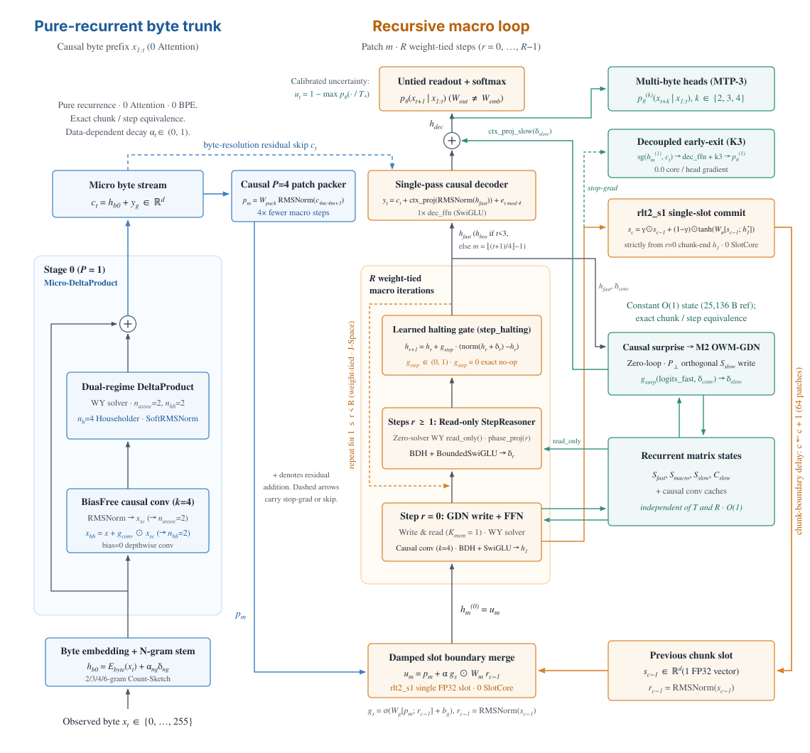
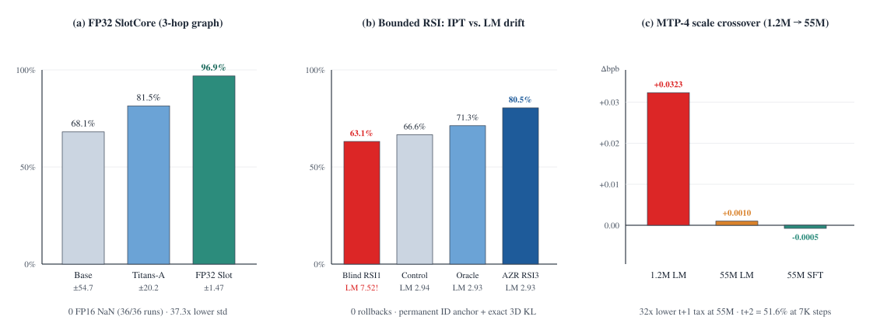

# Recursive Depth Flash Loop (`RDFL`)

**Ağırlık-Paylaşımlı Özyinelemeli Derinlik, FP32 Parça-Sınırı Belleği, Kopuk Spekülatif Başlıklar ve Doğrulayıcı-Kapılı Öz-Gelişim İçeren Bayt Düzeyi Sabit-Bellekli Hibrit Mimari**

[](LICENSE)
[](pyproject.toml)
[-1D6B5E.svg)](results/audited_summary.json)
[](benchmarks/verify_audited_results.py)

**[English](README.md)** · **[Türkçe](README.tr.md)** · **[Mimari Belirtim](docs/ARCHITECTURE.md)** · **[Denetlenmiş Özet JSON](results/audited_summary.json)** · **[Ham Denetim JSON'ları](results/raw/)**

---

## Özet

Standart otoregresif Transformer mimarilerinde anahtar–değer (KV) önbelleği dizi uzunluğuyla doğrusal $O(T)$ büyür; pencereli dikkat ise belleği sınırlamak uğruna pencere ufku $M$ ötesindeki durumu kaybeder. Saf doğrusal özyinelemeli modellerde ise seçici üzerine yazma (`MQAR`), negatif özdeğer gerektiren durum geçişleri (`Parity`, permütasyon grupları) ve çıpasız derinlik tekrarları kararsızlaşır.

**Recursive Depth Flash Loop (`RDFL`)**, tokenizer kullanmayan bayt düzeyi ($x_t \in \{0,\dots,255\}$) bir hibrit dizi mimarisidir; nedensel bir giriş gövdesini sabit boyutlu $O(1)$ durumlar üzerinde çalışan ağırlık-paylaşımlı bir özyinelemeli iyileştirme çekirdeğiyle birleştirir:

1. **Giriş-Çıpalı Özyinelemeli Derinlik:** Paylaşımlı özyinelemeli blok, her adımda normalize giriş çıpası ve adım gömmesiyle ($h_t^{(r-1)} + \alpha_r e_t + e_r$) $R$ kez yinelenir; çıpasız tekrarlarda görülen optimizasyon sürüklenmesini giderir.
2. **Householder Yazma Kapılı Parça-Paralel `Gated DeltaNet`:** Nedensel kısa konvolüsyon ($k=4$), çok-ölçekli yavaş sönümleme ($\alpha_0 \in [0{,}953, 0{,}999]$) ve $\beta_t = 2\sigma(\cdot) \in (0, 2)$ yazma kapısını birleştirir; dizi uzunluğundan bağımsız $S_t^{(r)} \in \mathbb{R}^{H \times d_h \times d_h}$ matris durumu taşır (`FP64`'te parça-paralel `forward == step` farkı `4,44e-16`).
3. **`BDH` Seyrek Etkileşim Kapısı ve Parça-Sınırı `FP32 SlotCore`:** İkili-seyrek ReLU etkileşimini parça sınırlarında kesin `float32` çalışan $S=4$ bellek bankasıyla eşleştirerek karma-hassasiyet taşmalarını giderir (`0/36` NaN; bkz. Bölüm 3.1 mekanistik simetrik çöküş bulgusu).
4. **Sıfır-Başlangıçlı Kalıntı Uyarlama ve Kayıpsız Yardımcı Başlıklar:** $W_{\uparrow}|_0 = 0$ çıkışı mevcut önceden eğitilmiş gövdelere adım-0'da `0,0` farkla bağlanır; kayıpsız spekülatif çözümleme (`K3` ve `MTP-4`, [`rdfl/speculative.py`](rdfl/speculative.py)), sıfır-parametreli kalibre belirsizlik (`MSP + T*`), deterministik araç yürütme (`ToolRunner`) ve doğrulayıcı-kapılı sınırlı öz-gelişim (`AZR` RSI) ile bütünleşir.

---

## 1. Mimari



*Şekil 1: `RDFL` hesaplama grafiği (aşağıdan yukarıya). Mavi yol nedensel giriş gövdesini ve dar çıpa projeksiyonunu; kehribar yol ağırlık-paylaşımlı özyinelemeli derinlik döngüsünü ve parça-sınırı `FP32 SlotCore` geri beslemesini; camgöbeği bloklar sabit $O(1)$ `Gated DeltaNet` matris durumlarını ve kopuk yardımcı tahmin başlıklarını (`K3`, `MTP-4`) gösterir. Tüm denklemler ve kaynakça [docs/ARCHITECTURE.md](docs/ARCHITECTURE.md) içindedir.*

---

## 2. Eş-Parametre `1,20M` Kıyaslamalar (`204` Kontrollü Koşu)

Tüm `1,20M` mimari kıyaslamalar 3 bağımsız tohumda yürütülmüş ve [`results/raw/ablasyon_sonuclari.json`](results/raw/ablasyon_sonuclari.json) üzerinden bağımsız denetimle doğrulanmıştır (`411/411` hücre eşleşti; donmuş kod özeti `ab9e7db6220038a6`; `186` çekirdek/ablasyon koşusunda `0` NaN; korumasız FP16 `A6_SLOT4_MESAJLI` kolunda görülen `2` FP16 NaN koşusu Bölüm 3'teki `FP32 SlotCore` tasarımını doğrudan tetiklemiştir).


Tüm 8 kol (`ortalama ± örneklem std`, 3 tohum; algoritmik sütunlar kuyruk / üzerine yazma / 3-atlama tanılama metrikleridir: `kuyruk_48_63_acc`, `kuyruk_24_31_acc`, `uzerine_yazilan_acc`, `3hop_acc`):

| Kol | Model Ailesi | Parametre | `Parity-64` kuyruk (%) | `S5-Perm32` kuyruk (%) | `MQAR Overwrite` (%) | `Multi-Hop ICL` 3-hop (%) | Bayt LM (`bpb` ↓) |
| :--- | :--- | :---: | :---: | :---: | :---: | :---: | :---: |
| `A0` | `RLT-0` (Geri-Beslemesiz) | `1,20M` | `50,18 ± 0,37` | `19,45 ± 0,65` | `22,40 ± 1,28` | `7,13 ± 0,88` | `2,4019 ± 0,0065` |
| `A1` | `RLT-1` (Token-Adımı) | `1,20M` | `79,78 ± 26,25` | `99,93 ± 0,12` | `21,96 ± 1,32` | `7,32 ± 0,49` | `2,3648 ± 0,0174` |
| `A2` | `RLT-2` (Parça Sınırı) | `1,20M` | `50,15 ± 0,43` | `20,27 ± 1,86` | `20,92 ± 1,31` | `7,03 ± 0,29` | `2,4207 ± 0,0217` |
| `A3` | `Flash Hebbian` (Ham) | `1,20M` | `64,68 ± 23,05` | `92,75 ± 3,73` | `3,21 ± 0,48` | `5,63 ± 2,48` | `2,3504 ± 0,0028` |
| `A4` | `GatedDeltaNet` (Eş-Param) | `1,20M` | `100,00 ± 0,00` | `73,13 ± 3,54` | `19,27 ± 7,73` | `6,12 ± 3,03` | `2,2786 ± 0,0050` |
| `A4B` | `GatedDeltaNet` (Eş-FLOP) | `2,57M` | `100,00 ± 0,00` | `95,17 ± 3,93` | `23,63 ± 1,31` | `3,97 ± 0,50` | **`2,1893 ± 0,0064`** |
| `A5` | `BDH-CQ Loop` | `1,20M` | `49,88 ± 0,40` | `72,09 ± 5,39` | `3,36 ± 0,23` | `3,29 ± 0,39` | `2,4676 ± 0,0041` |
| **`A6`** | **`RDFL` (`Delta+BDH+RLT2`)** | **`1,20M`** | **`100,00 ± 0,00`** | **`100,00 ± 0,00`** | **`100,00 ± 0,00`** | **`22,72 ± 1,30`** | `2,2896 ± 0,0060` |

- **Durum Belleği Ölçeklenmesi (`L=6, d=768, H=8`, `d_h=96`):** Ölçülen $T \in \{512,\, 4{,}096,\, 32{,}768\}$ bağlam uzunluklarında FP16 Tam-KV Transformer önbelleği `9,0 / 72,0 / 576,0 MiB` doğrusal büyürken `GatedDeltaNet` sabit **`1,7139 MiB`** (`1,71 MiB` ölçülen; $T=32{,}768$'de kesin **`336,1×`** küçülme) taşır (`python benchmarks/profile_decode_memory.py` ile CPU'da yeniden üretilebilir). `55M` eğitim bağlamı $T=8{,}192$'de `RLT-2` `3.072 MiB` tavanında OOM olurken `RDFL (R=2)` `1.877,4 MiB`'de eğitilir.

---

## 3. Denetlenmiş Öz-Yetenekler V2 (`ÖY-1 .. ÖY-10`) ve Mekanistik Dürüstlük



- **Öz-Yetenekler V2 (`662/662` hücre doğrulandı, ayrık tohumlar `42/137/2026`, `0` FP16 NaN):** Kopuk `K3`, `288/288` istemde sıfır bayt farkla `1,48×–1,54×` geri-alma düzeltmeli FLOP tasarrufu verir; `MSP + T*` sıfır ek parametreyle `1,2M`'de `AUROC 0,8424` (`+20,13` puan çekinme kazancı), `55M`'de `AUROC 0,8994 / 0,9041` (`%74,65 → %95,35` SFT doğruluğu) sağlar; istemden öz-düzeltme (`ÖY-5`) simetrik testte `D0` taslaklarını bozduğu için (`%87,37 → %48,44 / %49,22`) reddedilmiştir; hakemsiz kör RSI `7,5162 bpb`'ye çökerken doğrulayıcı-kapılı `AZR` RSI `0` geri almayla en iyi `LM = 2,9301 bpb` ve en yüksek `IPT = %80,45` değerine ulaşmıştır.

### 3.1 `graf_izli` Tohum Kırılımı ve Mekanistik Dürüstlük Bulgusu (`FP32 SlotCore` Simetrik Çöküş)

Görülmeyen tohumlarda `(42, 137, 2026)` `graf_izli` doğruluğu ([`results/raw/oy5_6_sonuclari.json`](results/raw/oy5_6_sonuclari.json)):

| Kol (`ÖY-6`, `1,20M`) | Tohum `42` | Tohum `137` | Tohum `2026` | Ort ± Std |
| :--- | :---: | :---: | :---: | :---: |
| `OY6_A6_TABAN` (Tek Vektör) | `%99,60` | `%99,77` | `%4,89` | `%68,09 ± 54,73` |
| `OY6_A6_BDHSIZ` (BDH'siz Eş-Param) | `%5,97` | `%99,34` | `%99,92` | `%68,41 ± 54,08` |
| `OY6_A6_SASKINLIK_GDN` (`Titans-A`) | `%99,61` | `%59,72` | `%85,06` | `%81,46 ± 20,19` |
| **`OY6_A6_SLOT4_FP32` (`FP32 SlotCore`)** | **`%95,30`** | **`%98,19`** | **`%97,17`** | **`%96,89 ± 1,47`** (`37,3×` düşük std) |

> **Mekanistik Dürüstlük Bulgusu (`FP32 SlotCore` Simetrik Çöküş):** Canlı eğitilmiş `55M` checkpoint'te (adım `17.500`, `16` gerçek metin parçası / `1.024` bayt): `init_slots` yuvaları arası kosinüs benzerliği başlangıçta **`0,48–0,69`** iken `16` parça sonunda tüm $S=4$ yuva arasındaki kosinüs benzerliği **`1,0000`** ve yuva normu **`~577`** değerine ulaşmaktadır (CPU'da `python benchmarks/run_1_2m_suite.py --smoke --measure-slot-cosine` komutuyla 8 parça sonrası dahi `cos ≈ 0,988` çöküşü doğrudan gözlenebilir). Bu bulgu, `FP32 SlotCore` kazancının "4 ayrı uzmanlaşmış yuva"dan değil, **parça sınırındaki birikimli `FP32` kalıntı durumdan** geldiğini açıkça göstermektedir. **`v0.3`** sürümü için rekabetçi yuva-eksenli `SlotAttn` (yuvalar üzerinde softmax rekabeti) + yuva-başı `RMSNorm` ve öğrenilebilir sönümleme/daraltma tasarımı planlanmıştır.

---

## 4. `55M` Sıcak Uyarlama, Kontrol Kapsamı ve Tekrarlanabilirlik

- **`1.500`-Adımlık `G0` / `G1` Kapısı (`saat1_mtp_kapisi.json`):** `G0` ($\lambda_{\text{MTP}} = 0$: `LM 512 = 1,1232`, `LM 2048 = 1,0344`, `SFT = 1,2415`) vs. `G1` ($\lambda_{\text{MTP}} = 0,15$: `LM 512 = 1,1242` [`+0,0010`], `SFT = 1,2410` [`-0,0005`], `MTP t+2/t+3/t+4 = %34,1 / %24,6 / %21,4`) karşılaştırması **`MTP-4`'ü izole eder** (`1,20M`'deki `+0,0323 bpb` vergi `55M`'de `32×` erir). Her iki kolda da `RDFL` açık olduğundan, `RDFL`'nin düz devam-eğitime karşı artımlı katkısını izole edecek **`RDFL`'siz devam-eğitim kontrolü (`G_BASE_ONLY`, `1.500` adım)** devam eden `42.000` adımlık ana koşu biter bitmez hemen çalıştırılıp denetlenecektir.
- **Ön Canlı Gözlemler (devam eden `42K` koşusu):** `7.000.` adımda `LM 512 = 1,1207`, `LM 2048 = 1,0277` (`-0,0142`), `MTP t+2 = %51,6`; `17.500.` adımda `LM 512 = 1,1188`, `LM 2048 = 1,0278`, `MTP t+2/t+3/t+4 = %54,2 / %42,5 / %34,5`.

```bash
git clone https://github.com/berkmec/Recursive-Depth-Flash-Loop.git
cd Recursive-Depth-Flash-Loop
pip install -e ".[dev]"
python -m unittest discover -s tests -v
python benchmarks/verify_audited_results.py
python benchmarks/profile_decode_memory.py
python benchmarks/run_1_2m_suite.py --smoke
python scripts/build_diagrams.py
```
