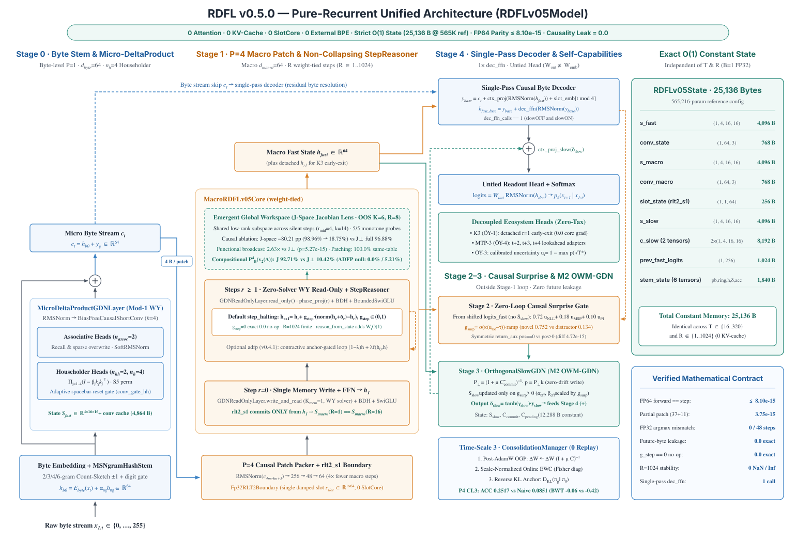
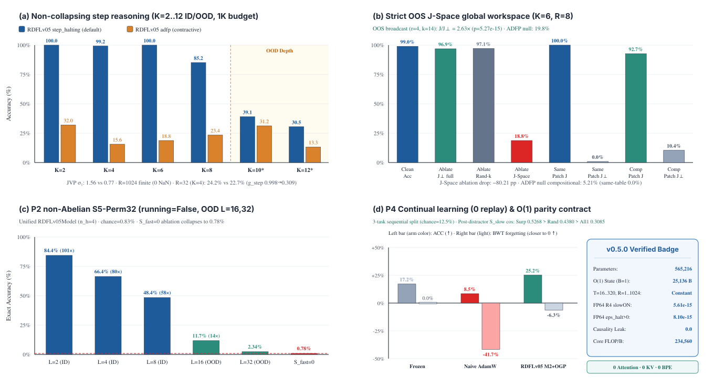

# Recursive Depth Flash Loop (`RDFL`)

**Ağırlık-Paylaşımlı Özyinelemeli Derinlik, Çökmeyen Adım-Adım Muhakeme + Öğrenilmiş Durma Kapısı, Nedensel Sürekli Bellek ve Kopuk Spekülatif Başlıklar İçeren Bayt Düzeyi Sabit-Bellekli Saf Özyinelemeli Mimari**

[](LICENSE)
[](pyproject.toml)
[](pyproject.toml)
[-1D6B5E.svg)](benchmarks/verify_audited_results.py)

**[English](README.md)** · **[Türkçe](README.tr.md)** · **[v0.5.0 Teknik Rapor](docs/V05_TECHNICAL_REPORT.md)** · **[Mimari Belirtim](docs/ARCHITECTURE.md)** · **[v0.5 Denetlenmiş JSON](results/v05_audited_summary.json)** · **[v0.3 Denetlenmiş Özet JSON](results/audited_summary.json)**

---

## Sürüm `v0.5.0` — Birleşik Saf Özyinelemeli `RDFLv05Model` (CPU Ölçeğinde Doğrulanmış)

> **Kapsam Ayrımı (`v0.5.0` CPU vs `v0.3` GPU 55M):** Aşağıdaki tüm `v0.5.0` ölçümleri [`benchmarks/verify_v05.py`](benchmarks/verify_v05.py) ile deterministik (`seed=42`, tek-CPU FP32/FP64) olarak çalıştırılmış ve [`results/v05_audited_summary.json`](results/v05_audited_summary.json) içine kaydedilmiştir. Eski `v0.3` pencereli-dikkat hibrit / `55M` GPU (`150M` token) sonuçları ve `782/782` denetlenmiş hücre aşağıda **Bölüm 4** altında ayrı başlıkta korunur. `v0.5-Reason 10M` GPU eğitimi sonraki aşama olarak planlanmıştır.

[`RDFLv05Model`](rdfl/v05.py) (`RDFLv05Config`, `RDFLv05State`, `ConsolidationManager`, `565,216` param), `v0.4.1` 4-problem saf özyinelemeli çekirdeğini çökmeyen adım-adım muhakeme + öğrenilmiş durma kapısı (`StepReasoner + Learned Halting Gate`) ile tek sabit-bellekli (`O(1)`) mimaride birleştirir (**`0` Attention · `0` KV-Cache · `0` SlotCore · `0` Harici BPE · `0` CUDA**).

---

## 1. Mimari (`RDFL v0.5.0` — Saf Özyinelemeli, Sıfır Attention)



*Şekil 1 (`v0.5.0`): [`RDFLv05Model`](rdfl/v05.py) saf özyinelemeli hesaplama grafiği (`565,216` param). **Aşama 0** (`P=1`, mavi), `256`-bayt gömme, `MSNgramHashStem` (`2/3/4/6`-gram) ve çift-rejimli `MicroDeltaProductGDNLayer` (`n_h=4` Householder çarpımı, `BiasFreeCausalShortConv`, `n_assoc=2` + `n_hh=2`) katmanlarını birleştirir. **Aşama 1** (`P=4`, kehribar), 4-baytlık nedensel yamaları `MacroRDFLv05Core` içine paketler (`r=0` tek `GDNReadOnlyLayer.write_and_read` + `rlt2_s1` sınırı, `r ≥ 1` çözücüsüz `read_only`, varsayılan çökmeyen `step_halting` + öğrenilmiş `g_step` kapısı ve ortaya çıkan `J-Space` Küresel Çalışma Alanı). **Aşama 2–3** (camgöbeği/kehribar, döngü dışı), sıfır-döngü nedensel şaşkınlık kapısını `OrthogonalSlowGDN` (`M2 OWM-GDN`) + sıfır-replay `ConsolidationManager` (`OGP + EWC + KL`) ile besler. **Aşama 4**, tek-geçişli `dec_ffn` (`calls == 1`), ayrık okuma başlığı, `K3`, `MTP-3` ve `ÖY-3` `MSP + T*` üretir; durum boyutu sabit **`25,136` bayt** (`B=1` FP32) kalır. Tüm denklemler ve tensör-tensör dökümü [docs/ARCHITECTURE.md](docs/ARCHITECTURE.md) içindedir.*

---

## 2. `v0.5.0` Denetlenmiş Kıyaslamalar ve `J-Space` Küresel Çalışma Alanı



*Şekil 2 (`v0.5.0`): Doğrudan [`results/v05_audited_summary.json`](results/v05_audited_summary.json) dosyasından üretilen 4-panelli özet: **(a)** `K=2..12` derinliğinde çökmeyen `step_halting` vs büzülen `adfp` (`1.000` adımlık CPU bütçesi), **(b)** sıkı OOS `J-Space` Küresel Çalışma Alanı ablasyonu ve bileşik kavram nakli (`K=6, R=8`), **(c)** `P2` Abelyen-olmayan `S5-Perm32` (`running=False`, `L=2..32` OOD vs `S_fast=0`) ve **(d)** `P4` `0`-replay sürekli öğrenme (`M2 + OGP/EWC`) + `O(1)` parite rozeti.*

- **Saf Değişmezler & Parite:**
  - `FP64 forward == step` (`R=2,4`, `slowOFF/ON`): maks. fark **`5.27e-15 .. 5.72e-15`** (`≤ 1e-13`); kısmi-yama `37+11` **`3.75e-15`**; `random_matched` **`5.38e-15`**; `eps_halt > 0` **`8.10e-15`**; **`0` FP32 argmax uyuşmazlığı**.
  - Nedensellik `0.0`; `return_aux=True` `pos==0` vs `pos>0` simetrisi (`keys_match=true`, `4.72e-15`); `gate_override == 0.0` birebir no-op (`0.0`); kesin `O(1)` durum (**`25,136` bayt**, `T=16..320` ve `R=1..1024`); `R=1024` sıfır NaN/Inf (`h_norm_max = 9.2451`, `w_norm_max = 7.2491`); `K3` çekirdek gradyanı `0.0`; tek-geçiş `dec_ffn_calls == 1`.
- **Çökmeyen Adım-Adım Muhakeme & Durma Kapısı (`step_halting` vs `adfp`, eşit `1.000`-adım bütçesi):**
  - Değişken derinlikli işaretçi takibi (`0` ara-adım denetimi): **`K=2: 1.0000`, `K=4: 0.9922`, `K=6: 1.0000`, `K=8: 0.8516`, OOD `K=10: 0.3906`, `K=12: 0.3047`** (eşit bütçeli büzülen `"adfp"` kolu aşama 1'de `0.1328..0.3203`'te kalır; `mean_step_jvp_top_sv = 0.7703` vs `step_halting` `1.5621`).
  - Öğrenilmiş `g_step` kapısı fazla döngülerde söner (`K=4, R=64`: `0.9978 → 0.2881`; `K=6, R=64`: `0.9976 → 0.3040`) ve `eps_halt=0.40` dinamik erken çıkışı tetikler (`r_used_mean = 12.08..22.66`), `R=1024`'te normlar sınırlı kalır (dürüst kısıt notu: 1,000 adımlık bu CPU bütçesinde `R=16..64` ek adımları kapının `~0.30` yerine anında `<0.05`'e düşmemesinden ötürü `K=4,6` doğruluğunu `0.1641..0.3281`'e düşürmektedir).
- **Anthropic Global Workspace (`J-Space` / Jakobiyen Merceği, Sıkı OOS `x_cal → x_te`, `K=6, R=8`, `clean_acc = 0.9896` vs `adfp` `0.1979`):**
  - Monoton ara-adım doğrusal sondaları (`5/5` ardışık tepe `r=[1,4,5,6,7,8]`, doğruluk `0.9688..1.0000`) ve sıralı kesinti okuması (`v_1..v_6` sırayla `r=3..8` adımlarında `0.9896..1.0000` tepe).
  - **OOS Varyans Şerhi (`OOS var_J`):** `d=64`'te `J-space` (`k90=11..37`), `h_r` varyansının **`%42,15 → %93,87`**'sini taşır (yani yüksek-boyutlu `<%10` varsayımı sağlanmaz), ancak nedensel ablasyon ve kavram nakli `J`'yi `J_perp`'ten net biçimde ayırır.
  - OOS fonksiyonel küresel yayın (`r_mid=4, k=14`): `J-space` `0.6226` vs `J_perp` `0.2364` (**`2.6335×`**, `p = 5.27e-15`) ve rastgele-`k` `0.3374` (**`1.8453×`**, `p = 7.80e-15`; `adfp` sıfır kontrolü `0.9984×`, `p = 0.380`).
  - OOS seçici ablasyon (`r_mid=4`): `J-space` silinince `0.9896 → 0.1875` (`-0.8021`), tam `J_perp` `0.9688`, rastgele `0.9708`.
  - OOS kavram & bileşik nakil (`93/96` temiz çift): `J-space` aynı-tablo `flip_to_A = 1.0000` vs `J_perp` `0.0` (`keep_B = 0.9785`); farklı-tablo bileşik $P_B^4(v_2(A))$ = **`0.9271`** vs `J_perp` **`0.1042`** (`adfp` kontrolü `flip_to_A = 0.0`, bileşik `0.0521`).
- **4-Problem Regresyon Kilidi (Tek `RDFLv05Model` Sınıfı):**
  - **P1:** `dyck_stack` `t80_s_macro_r1_vs_r16_diff = 0.0` (`R1=0.2604 → R16=0.2639`).
  - **P2 (`s5_perm32`, `running=False`, sıkı OOD `L ≤ 8`):** **`L2 = 0.8438` (`101.3×` şans `0.00833`), `L4 = 0.6641`, `L8 = 0.4844`, OOD `L16 = 0.1172`, `L32 = 0.0234`**; `s_fast=0` ablasyonu `0.0078`.
  - **P3:** `dec_ffn_calls = 1`, hook FLOP/B `250,816` (`slowOFF`) / `302,272` (`slowON`), kayma `+1/+17` `+0.0047 / +0.0036` (`bpb=0.6933`).
  - **P4 (`0` replay sürekli öğrenme):** `ACC = 0.2517` vs `frozen = 0.1719` vs `naive_adamw = 0.0851` (`BWT = -0.0625` vs `-0.4167`); akışlı `g_surp` `0.3498 / 0.7522 / 0.1335`, çeldirici sonrası `S_slow` kosinüs `0.5268 > rand 0.4380 > always_one 0.3085`; adaptif boşluk kapısı `copy_l16` `p4 |λ| = 0.9440` vs `shuf16_bag = 0.8643`.

---

## 3. Hızlı Başlangıç ve Tek-Komutla Doğrulama (CPU)

```bash
git clone https://github.com/berkmec/Recursive-Depth-Flash-Loop.git
cd Recursive-Depth-Flash-Loop
pip install -e ".[dev]"

# 1. Tam birim test paketi (19/19: 13 eski v0.3 + 6 birleşik v0.5 parite/saflık/O(1)/no-op testi)
python -m unittest discover -s tests -v

# 2. Birleşik v0.5 değişmezlerini, durma kapısını, OOS J-space'i ve P1-P4 kilidini doğrula -> results/v05_audited_summary.json
ruff check rdfl benchmarks tests scripts
mypy --strict rdfl/v05.py benchmarks/verify_v05.py rdfl/__init__.py tests/test_rdfl_v05.py
python benchmarks/verify_v05.py --out results/v05_audited_summary.json

# 3. Eski v0.3 782 denetlenmiş hücreyi results/raw/*.json dosyalarına karşı programatik doğrula
python benchmarks/verify_audited_results.py

# 4. Eski v0.3 O(1) çözümleme durumunu FP16 Tam-KV önbelleğiyle CPU PyTorch üzerinde ölç
python benchmarks/profile_decode_memory.py

# 5. Eski 1.20M algoritmik suite (4 görev x 4 kol) + SlotCore kosinüs tanılaması (<10 sn CPU)
python benchmarks/run_1_2m_suite.py --smoke

# 6. Tüm 5 vektör figürü (2 v0.5.0 + 3 eski v0.3) doğrudan denetlenmiş JSON'lardan üret ve XML doğrula
python scripts/build_diagrams.py
```

### Python Hızlı Başlangıç (`RDFL v0.5.0` — Saf Özyinelemeli `RDFLv05Model`)

```python
import torch
from rdfl import ConsolidationManager, RDFLv05Config, RDFLv05Model
from rdfl.v05 import state_nbytes

cfg = RDFLv05Config()
x = torch.randint(0, 256, (1, 16))

# 1. Kesin O(1) FP32 durum (25,136 B) ve FP64 forward_stateful() == step() paritesi
model_f32 = RDFLv05Model(cfg).eval()
_, _, _, st_f32 = model_f32.forward_stateful(x)
assert state_nbytes(st_f32) == 25136

model = model_f32.double().eval()
lg_chunk, _, _, st_chunk = model.forward_stateful(x, num_loops=4, update_slow=True)
st_step = None
step_logits = []
for t in range(x.shape[1]):
    lg_t, st_step = model.step(x[:, t : t + 1], st_step, num_loops=4, update_slow=True)
    step_logits.append(lg_t)
assert (lg_chunk - torch.cat(step_logits, dim=1)).abs().max().item() <= 1e-13
assert state_nbytes(st_chunk) == state_nbytes(st_step)

# 2. O(1) durumdan sessiz çok-adımlı muhakeme (gate_override=0.0 iken bit-birebir no-op)
h0, s_fast, c_last, slot_idx = model.encode_for_reasoning(x)
res = model.reason_from_state(h0, s_fast, c_last, num_loops=6, slot_idx=slot_idx, eps_halt=0.4)
noop = model.reason_from_state(h0, s_fast, c_last, num_loops=6, slot_idx=slot_idx, gate_override=0.0)
assert (noop["h_final"] - h0).abs().max().item() == 0.0

# 3. Sıfır-replay sürekli öğrenme yöneticisi (OGP + Online EWC + ters KL)
cm = ConsolidationManager(model.float())
assert cm.penalty_loss().item() == 0.0
```

### Eski `v0.3` Adaptör Kullanımı (`RDFLModel` / `ZeroDiffRDFLAdapter`)

```python
import torch
from rdfl import (
    RDFLConfig,
    RDFLModel,
    ZeroDiffRDFLAdapter,
    greedy_decode,
    msp_uncertainty,
    speculative_decode_k3,
    speculative_decode_mtp4,
)

cfg = RDFLConfig(d_model=192, num_heads=6, ffn_dim=512, num_loops=2, num_slots=4)
model = RDFLModel(cfg).double().eval()
prompt = torch.randint(0, 256, (1, 32))

# K3 ve MTP-4 ile 0-bayt-farklı kayıpsız spekülatif çözümleme
ref = greedy_decode(model, prompt, max_new_tokens=16)
res_k3 = speculative_decode_k3(model, prompt, max_new_tokens=16, draft_k=2)
res_mtp = speculative_decode_mtp4(model, prompt, max_new_tokens=16)
assert (res_k3.tokens == ref).all() and (res_mtp.tokens == ref).all()

# Sıfır-parametreli MSP belirsizlik ve adım-0 sıfır-farklı omurga adaptörü
logits, _, _, _ = model.forward_stateful(prompt)
conf, unc = msp_uncertainty(logits)
adapter = ZeroDiffRDFLAdapter(d_base=1536, d_narrow=384, num_heads=6, num_loops=2)
z_base = torch.randn(1, 32, 1536)
assert (adapter(z_base) - z_base).abs().max().item() == 0.0
```

---

## 4. Eski `v0.3` Hibrit Tabanı (Pencereli Dikkat + `FP32 SlotCore`)

> **Eski `v0.3` Uyarısı:** Aşağıdaki **Bölüm 4** diyagramı ve deneyleri eski **`v0.3` pencereli-dikkat hibrit / `55M` yan-dal** mimarisine aittir (`rdfl/model.py`, `rdfl/layers.py`, [`results/audited_summary.json`](results/audited_summary.json), [`results/raw/`](results/raw/)). Güncel `v0.5.0` (`rdfl/v05.py`) **sıfır Attention, sıfır RoPE ve sıfır SlotCore** içerir — yukarıdaki **Bölüm 1–2**'ye bakınız.

### 4.1 Eski `v0.3` Özet ve Hibrit Mimari

Standart otoregresif Transformer mimarilerinde anahtar–değer (KV) önbelleği dizi uzunluğuyla doğrusal $O(T)$ büyür; pencereli dikkat ise belleği sınırlamak uğruna pencere ufku $M$ ötesindeki durumu kaybeder. Saf doğrusal özyinelemeli modellerde ise seçici üzerine yazma (`MQAR`) ve negatif özdeğer gerektiren durum geçişleri (`Parity`, permütasyon grupları) zayıflar.

Eski `v0.3` **Recursive Depth Flash Loop (`RDFL`)**, nedensel bir giriş gövdesini sabit boyutlu $O(1)$ durumlar üzerinde çalışan ağırlık-paylaşımlı bir özyinelemeli iyileştirme çekirdeğiyle birleştiriyordu:

1. **Ağırlık-Paylaşımlı Özyinelemeli Derinlik (Opsiyonel Giriş Çıpalı):** Paylaşımlı özyinelemeli blok $R$ kez yinelenir ($h_t^{(r-1)} + \alpha_r e_t + e_r$). Kontrollü `1,20M` ablasyonları (Bölüm 4.2), kazanımın giriş çıpalamasından tek başına değil **`GatedDeltaNet + BDH + RLT-2` sinerjisinden** geldiğini göstermiştir.
2. **Householder Yazma Kapılı Parça-Paralel `Gated DeltaNet`:** Nedensel kısa konvolüsyon ($k=4$), çok-ölçekli yavaş sönümleme ($\alpha_0 \in [0{,}953, 0{,}999]$) ve $\beta_t = 2\sigma(\cdot) \in (0, 2)$ yazma kapısını birleştirir; $S_t^{(r)} \in \mathbb{R}^{H \times d_h \times d_h}$ matris durumu taşır (`FP64`'te parça-paralel `forward == step` farkı `4,44e-16`).
3. **`BDH` Seyrek Etkileşim Kapısı ve Parça-Sınırı `FP32 SlotCore` (`v0.3`'te Ertelendi / Değiştirildi):** Doğrudan `55M` ablasyonu sıfır durum-izleme katkısı (`delta_durum = 0,0`, `delta_bpb = -0,0005 / -0,0003`) ve simetrik yuva çöküşü (`cos = 0,999982`, Bölüm 4.3.1) gösterdiğinden simetrik `SlotCore` `v0.3`'te `rlt2_s1` ile değiştirilmiş, `v0.5.0`'da tamamen kaldırılmıştır.
4. **Sıfır-Başlangıçlı Kalıntı Uyarlama ve Kayıpsız Yardımcı Başlıklar:** $W_{\uparrow}|_0 = 0$ çıkışı mevcut önceden eğitilmiş gövdelere adım-0'da `0,0` farkla bağlanır; kayıpsız spekülatif çözümleme (`K3` ve `MTP-4`, [`rdfl/speculative.py`](rdfl/speculative.py)), sıfır-parametreli kalibre belirsizlik (`MSP + T*`), sıfır-kalıntılı halka akış tamponu ve doğrulayıcı-kapılı sınırlı öz-gelişim (`AZR` RSI) ile bütünleşir.


*Şekil 3 (Eski `v0.3`): Eski `v0.3` hibrit uyarlayıcı (`RDFLModel` / `ZeroDiffRDFLAdapter`) hesaplama grafiği. Mavi yol pencereli-dikkat giriş gövdesini; kehribar yol ağırlık-paylaşımlı döngüyü ve `FP32 SlotCore` geri beslemesini; camgöbeği bloklar $O(1)$ `Gated DeltaNet` durumlarını ve `K3` / `MTP-4` başlıklarını gösterir. Bkz. [docs/ARCHITECTURE.md §2](docs/ARCHITECTURE.md#2-legacy-v03-reference-architecture-windowed-attention-hybrid--fp32-slotcore).*

### 4.2 Eski Eş-Parametre `1,20M` Kıyaslamalar (`204` Kontrollü Koşu)

Tüm `1,20M` mimari kıyaslamalar 3 bağımsız tohumda yürütülmüş ve [`results/raw/ablasyon_sonuclari.json`](results/raw/ablasyon_sonuclari.json) üzerinden doğrulanmıştır (donmuş kod özeti `ab9e7db6220038a6`; `186` çekirdek/ablasyon koşusunda `0` NaN; korumasız FP16 `A6_SLOT4_MESAJLI` kolunda görülen `2` FP16 NaN koşusu Bölüm 4.3'teki `FP32 SlotCore` tasarımını doğrudan tetiklemiştir).


Tüm 8 kol (`ortalama ± örneklem std`, 3 tohum; algoritmik sütunlar kuyruk / üzerine yazma / 3-atlama tanılama metrikleridir: `kuyruk_48_63_acc`, `kuyruk_24_31_acc`, `uzerine_yazilan_acc`, `3hop_acc`):

| Kol | Model Ailesi | Parametre | `Parity-64` kuyruk (%) | `S5-Perm32` kuyruk (%) | `MQAR Overwrite` (%) | `Multi-Hop ICL` 3-hop (%) | Bayt LM (`bpb` ↓) |
| :--- | :--- | :---: | :---: | :---: | :---: | :---: | :---: |
| `A0` | `RLT-0` (Geri-Beslemesiz) | `1,20M` | `50,18 ± 0,37` | `19,45 ± 0,65` | `22,40 ± 1,28` | `7,13 ± 0,88` | `2,4019 ± 0,0065` |
| `A1` | `RLT-1` (Token-Adımı) | `1,20M` | `79,78 ± 26,25` | `99,93 ± 0,12` | `21,96 ± 1,32` | `7,32 ± 0,49` | `2,3648 ± 0,0174` |
| `A2` | `RLT-2` (Parça Sınırı) | `1,20M` | `50,15 ± 0,43` | `20,27 ± 1,86` | `20,92 ± 1,31` | `7,03 ± 0,29` | `2,4207 ± 0,0217` |
| `A3` | `Flash Hebbian` (Ham) | `1,20M` | `64,68 ± 23,05` | `92,75 ± 3,73` | `3,21 ± 0,48` | `5,63 ± 2,48` | `2,3504 ± 0,0028` |
| `A4` | `GatedDeltaNet` (Eş-Param) | `1,20M` | `100,00 ± 0,00` | `73,13 ± 3,54` | `19,27 ± 7,73` | `6,12 ± 3,03` | `2,2786 ± 0,0050` |
| `A4B` | `GatedDeltaNet` (Eş-FLOP) | `2,57M` | `100,00 ± 0,00` | `95,17 ± 3,93` | `23,63 ± 1,31` | `3,97 ± 0,50` | **`2,1893 ± 0,0064`** |
| `A5` | `BDH-CQ Loop` | `1,20M` | `49,88 ± 0,40` | `72,09 ± 5,39` | `3,36 ± 0,23` | `3,29 ± 0,39` | `2,4676 ± 0,0041` |
| **`A6`** | **`RDFL` (`Delta+BDH+RLT2`)** | **`1,20M`** | **`100,00 ± 0,00`** | **`100,00 ± 0,00`** | **`100,00 ± 0,00`** | **`22,72 ± 1,30`** | `2,2896 ± 0,0060` |

- **`Multi-Hop ICL` Derece-Filtreleme Şerhi (`KPN-Y01`):** `RDFL`'nin `%22,72 ± 1,30` 3-hop doğruluğu `A4B` (`%3,97`, `5,7×`) ve `A0` (`%7,13`) kollarını açık ara geçse de **yapısal derece-filtreleme tavanı (`1/4 = %25,0` / `1/8 = %12,5`, birleşik `%18,75`) içinde yer alır**; bu nedenle sınırsız çok-atlamalı graf gezintisinden ziyade bağlam-içi yapısal düğüm-rolü takibi kanıtıdır.
- **Durum Belleği Ölçeklenmesi (`L=6, d=768, H=8`, `d_h=96`):** Ölçülen $T \in \{512,\, 4{,}096,\, 32{,}768\}$ bağlam uzunluklarında FP16 Tam-KV Transformer önbelleği `9,0 / 72,0 / 576,0 MiB` doğrusal büyürken `GatedDeltaNet` sabit **`1,7139 MiB`** (`1,71 MiB` ölçülen; $T=32{,}768$'de kesin **`336,1×`** küçülme) taşır (`python benchmarks/profile_decode_memory.py` ile CPU'da yeniden üretilebilir). `55M` eğitim bağlamı $T=8{,}192$'de `RLT-2` `3.072 MiB` tavanında OOM olurken `RDFL (R=2)` `1.877,4 MiB`'de eğitilir.
- **Yapısal ve Giriş Çıpalama Ablasyonları (`dongu_cipa_rlt2_ablasyonu`):**
  - *Parça-Sınırı (`RLT-2`):* Kaldırıldığında (`A6_R4_rlt2siz`) `Multi-Hop ICL` `%22,72 ± 1,30 → %10,32 ± 11,20` (`-12,40 puan`, `8,6×` yüksek std) düşer.
  - *Döngü Derinliği (`R`):* `A6_R2_cipali` (`%23,28 ± 0,92`, `2,2903 bpb`), `A6_R4_cipali`'yi `1,8×` yüksek verimle (`34,43` vs `19,00 KB/sn`) yakalar.
  - *Giriş Çıpalama (`cipali` vs `cipasiz` — Dürüst Sıfır-Etki Bulgusu):* `A6_R4_cipasiz` (`%22,69 ± 1,76`, `2,2843 ± 0,0065 bpb`), `A6_R4_cipali` ile (`%22,72 ± 1,30`, `2,2896 ± 0,0060 bpb`) `Multi-Hop`'ta eşdeğer, `Byte LM`'de hafifçe daha iyidir; `A5_R4_cipasiz` de her iki metrikte (`%3,71` vs `%3,29`; `2,4379` vs `2,4676 bpb`) `A5_R4_cipali`'yi geçer. Çekirdek kazanım giriş çıpalamasından değil **`GatedDeltaNet + BDH + RLT-2` sinerjisinden** gelmektedir.

### 4.3 Eski Denetlenmiş Öz-Yetenekler (`ÖY-1 .. ÖY-10` Tam Kapsam Şeffaflığı)

`ÖY-1 .. ÖY-8`, kalibrasyon tohumundan (`401`) ayrık görülmeyen tohumlarda `(42, 137, 2026)` yürütülmüştür (kod özeti `c8c2744cd90baca1`; `0` FP16 NaN; tepe `1.705,7 MiB` VRAM). `ÖY-9` ve `ÖY-10` durumları abartısız biçimde tabloda açıkça belirtilmiştir:


| No & Mekanizma | Karar / Durum | Denetlenmiş Ampirik Bulgular (`results/raw/*.json`) |
| :--- | :---: | :--- |
| **`ÖY-1/1B`: `K3` Kopuk Erken Çıkış & Spekülatif Çözümleme** | **Kabul** | Kopuk `R=1` başlığı `R=1` LM'yi `-0,3899 bpb` (`2,8886 → 2,4987`) iyileştirir (`R=4` vergisi `+0,0041 bpb`). `288/288` istemde **`0` bayt fark**, `1,48×–1,54×` geri-alma düzeltmeli FLOP tasarrufu (`1,09×` `K3/K2`, `0,991×` `K3/K4`, `1,28×` `K1/K4` duvar-saati). |
| **`ÖY-2`: Durumlu Uyarlamalı Derinlik** | **Koşullu** | Parça (`B=32`) erken çıkış `byte_lm`'de `%25,69` FLOP tasarrufuna karşılık `+0,0444 bpb / -0,94 puan`, `graf_izli`'de `%36,38` FLOP tasarrufuna karşılık `+0,0662 bpb / +0,23 puan` verir; pratikte kayıpsız `K3` spekülatif çözümleme tercih edilir. |
| **`ÖY-3`: Kalibre `MSP + T*` Belirsizlik** | **Kabul** | Sıfır ek parametre: `1,2M` `AUROC = 0,8424`, `ECE15 = 0,0116`, `%40` çekinmede `+20,13 puan` (`%52,68 → %72,81`), `8,32×` düşük graf ECE; `55M`'de **`AUROC = 0,8994 / 0,9041`** (`%74,65 → %95,35` SFT doğruluğu). |
| **`ÖY-4`: `MTP-4` Çok-Baytlı İleri Bakış** | **Kabul (`55M+`)** | **`46×` ölçek geçişi:** `1,20M`'deki `+0,0323 bpb` LM (`+0,0272` `rsi_L34`) vergisi, açık `55M` yayılımında **`32×`** eriyerek `+0,0010 bpb` LM ve `-0,0005 bpb` SFT'ye iner (eğitilmemiş adım-0 duvar-saati `0,501×`). |
| **`ÖY-5`: İstemden Öz-Düzeltme & MLP Doğrulayıcı** | **Ret** | Simetrik `T=0,0` testinde istem revizyonu eşit adımlı `D0` taslaklarını bozdu (`%87,37 → %48,44 / %49,22`). Sıfır-parametreli `log p` (`AUROC = 0,9513`), 25K MLP doğrulayıcıyı (`0,5867`) açık ara geçti. |
| **`ÖY-6`: `FP32 SlotCore` Parça-Sınırı Belleği** | **Ertelendi / `v0.3`'te Değiştirildi** | `1,20M`'de `0/36` NaN; `graf_izli` `%68,09 ± 54,73 → %96,89 ± 1,47` (`37,3×` düşük std), `MQAR %99,88` (`+0,0173 bpb` LM vergisi). **`55M`'de (`1,33M` param):** durum izlemede `slot_acik == slot_kapali` (`%59,38` vs `%59,38`, **`delta_durum = 0,0`**), `delta_bpb = -0,0005` (Ana) / `-0,0003` (RSI) ve 4 yuva **`cos = 0,999982`** çöküşü (Bölüm 4.3.1). `BDH`, `BDH`'siz koldan `3/3` tohumda iyi (`-0,0071 bpb`). |
| **`ÖY-7`: Doğrulayıcı-Kapılı Sınırlı `AZR` RSI** | **Kabul (Sınırlı + SFT Koruma)** | `1,20M` (`75` nesil): kör `RSI1` çöktü (`LM 7,5162`), `AZR` en iyi `LM = 2,9301`, `0` rollback, `ID %98,44`, `IPT %80,45`. `55M` (`8` nesil, `0` rollback): `L=4 ↔ L=5` duvarı (`96/96` vs `0/96` kabul) ve SFT/`EOT` tekrarı olmayan entropi bonusuyla `completion 0,78 → 0,58`, `repetition 0,40 → 0,60` gerilemesi (Bölüm 4.4). |
| **`ÖY-8`: Sıfır-Kalıntılı Halka Akış Tamponu** | **Kabul** | Makbuz-kilitli halka tampon `32,0 MiB` akışta `4,0 MiB` tepe, `0,0 MiB` son disk ve `0,0 MiB` VRAM ile çalışır. |
| **`ÖY-9`: Çevrimiçi Ağırlık Öz-Düzenleme (`SEAL` / `E-SELF`)** | **Ertelendi (Kapsam Dışı)** | Yalnızca literatür incelemesinde değerlendirildi; V2 deney matrisinden ertelendi (bağımsız deney iddiası yoktur). |
| **`ÖY-10`: `ToolRunner` (`<calc>` / `<check>` / `<note>`)** | **Kabul (Şablon Kapsamı)** | Kod harici eğitim deposundadır. `24` aritmetik istemde: eğitim-öncesi `55M` taban `%0,0` → `Ana 21K`, `RSI (8 nesil)` ve `RDFL`'siz `G_BASE_ONLY (1,5K)` üçü de **`%100,0` çağrı / `%100,0` doğruluk** (`%0,0` araçsız); ortak-uyarlanmış `en_iyi.pt` (`21K`) üzerinde `RDFL` kapatıldığında `%54,17`'ye düşer. |

#### 4.3.1 `graf_izli` Tohum Kırılımı, Eş-Parametre `Byte LM` Vergisi ve Mekanistik Çöküş Bulgusu

Görülmeyen tohumlarda `(42, 137, 2026)` `graf_izli` ve `Byte LM` ([`results/raw/oy5_6_sonuclari.json`](results/raw/oy5_6_sonuclari.json)):

| Kol (`ÖY-6`, `1,20M`) | `graf_izli` Tohumlar `(42 / 137 / 2026)` | `graf_izli` Ort ± Std | Bayt LM (`bpb` ↓) |
| :--- | :---: | :---: | :---: |
| `OY6_A6_TABAN` (`ffn=512`, Tek Vektör) | `%99,60 / %99,77 / %4,89` | `%68,09 ± 54,73` | `2,3646 ± 0,0017` |
| `OY6_A6_BDHSIZ` (`ffn=896`, BDH'siz) | `%5,97 / %99,34 / %99,92` | `%68,41 ± 54,08` | `2,3717 ± 0,0030` |
| `OY6_A6_SASKINLIK_GDN` (`Titans-A`) | `%99,61 / %59,72 / %85,06` | `%81,46 ± 20,19` | **`2,3641 ± 0,0015`** |
| **`OY6_A6_SLOT4_FP32` (`ffn=128`, `FP32 SlotCore`)** | **`%95,30 / %98,19 / %97,17`** | **`%96,89 ± 1,47`** | `2,3819 ± 0,0055` (`+0,0173`) |

- **Eş-Parametre `Byte LM` Gerilemesi (`+0,0173 bpb`):** `1,20M` eş-parametre bütçesinde `FP32 SlotCore` eklemek için `ffn` boyutunun `512 → 128` daraltılması `Byte LM`'de `+0,0173 bpb` vergiye yol açmıştır (`2,3819` vs `2,3646`). `55M` ölçeğinde bu vergiyi önlemek için `SlotCore` daraltılmamış `ffn=3072` omurga dışına eklenir.
- **Mekanistik Dürüstlük Bulgusu (`FP32 SlotCore` Simetrik Çöküş & `55M` Sıfır Katkı — [`slotcore_55m_cosine_probe.json`](results/raw/slotcore_55m_cosine_probe.json), [`ana_55m_degerlendirme.json`](results/raw/ana_55m_degerlendirme.json)):** Eğitilmiş `55M` checkpoint'te (adım `21.000`, `16` gerçek parça / `1.024` bayt `mix/validation.bin`, CPU ölçümü): `init_slots` kosinüsü `0,5017–0,7512` (`ort = 0,6446`) iken `16` parça sonunda tüm $S=4$ yuva **`0,999982`** (`min = 0,999959`, `maks = 0,999999`) kosinüse ve **`664,5`** L2 normuna çökmüştür. Tam `55M` ablasyonu da **`delta_durum = 0,0`** (`%59,38` açık vs `%59,38` kapalı) ve ihmal edilebilir `delta_bpb_2048 = -0,0005` (Ana) / `-0,0003` (RSI) göstermiştir → simetrik `SlotCore` `v0.3`'te `rlt2_s1` ile değiştirilmiştir.

### 4.4 Tamamlanan `55M` Uyarlama, `G_BASE_ONLY` Nedensel Kontrolü ve `ÖY-7` RSI (`Diogenes-RDFL-55M`)

> **Denetim Durumu:** Aşağıdaki `55M` final çıktılarının tamamı [`results/raw/`](results/raw/) ham JSON'larına karşı **`782/782`** hücrede `0` uyuşmazlıkla doğrulanmıştır (`kod_sha256 = 3c1a59a1dd2bb0f7`) ve bağımsız sıfır-bağlamlı Carbon kapanış denetiminden **PASS** (`0 KRITIK, 0 YUKSEK, 0 ORTA`) almıştır.

- **`G_BASE_ONLY` (`1.500` adım, `RDFL` KAPALI) vs `G0` / `G1` & `42K` Seyri (`fast-val`, [`g_base_only_kontrol.json`](results/raw/g_base_only_kontrol.json), [`saat1_mtp_kapisi.json`](results/raw/saat1_mtp_kapisi.json), [`ana_egitim_ozet.json`](results/raw/ana_egitim_ozet.json)):**
  - Adım-0 taban: `1,1268 / 1,0419 / 1,2416` (`bileşik 1,1200`).
  - **`G_BASE_ONLY` (`1,5K`, yalnız `55,08M core + 0,86M reader`, `maks|delta_z| == 0,0`):** **`437,9 sn` (`3,3×` hızlı)**, `2.770,6 MiB`, `0` NaN/atlanan → `1,1231 / 1,0346 / 1,2410` (**`bileşik 1,1157`**), `OY-10 %100`, `durum %25,0`.
  - `G0` (`1,5K`, $\lambda_{\text{MTP}}=0$, `RDFL` ON): `1,1232 / 1,0344 / 1,2415` (`bileşik 1,1158`, `1.448,9 sn`, `2.981,9 MiB`).
  - `G1` (`1,5K`, $\lambda_{\text{MTP}}=0,15$, `RDFL` ON): `1,1242 / 1,0362 / 1,2410` (`bileşik 1,1167`, `1.517,0 sn`, `3.833,9 MiB`, `MTP t+2/3/4 = %34,1 / %24,6 / %21,4`).
  - Ana Eğitim (`42K` toplam `41.894,8 sn`, tepe `3.443,5 MiB`, `15` atlanan): En iyi bileşik Adım `21.000` (`en_iyi.pt = 1,1124`: `1,1197 / 1,0254 / 1,2485`, `MTP %54,9/%42,9/%35,4`); Adım `42.000` (`son.pt`: `1,1169 / 1,0231 / 1,2998` [dar SFT ezberi], `MTP %55,9/%44,0/%35,8`).
- **Tam Batarya (`full-val`) ve `en_iyi.pt` (`21K`) `RDFL ON vs OFF (delta_z = 0)` Ablasyonu ([`ana_55m_degerlendirme.json`](results/raw/ana_55m_degerlendirme.json), [`rsi_55m_degerlendirme.json`](results/raw/rsi_55m_degerlendirme.json), [`oy7_rsi_55m.json`](results/raw/oy7_rsi_55m.json)):**
  - `Taban → Ana 21K (RDFL ON) → Ana 21K (RDFL OFF) → RSI (8 nesil)`:
    - `mix512_r2_bpb`: `1,1549 → 1,1467` vs `1,1477` (`Δ = -0,0010`) `→ 1,1452`
    - `mix2048_r2_bpb`: `1,0718 → 1,0566` vs `1,0568` (`Δ = -0,0002`) `→ 1,0547`
    - `web2048_r2_bpb`: `1,4067 → 1,3878` vs `1,3878` (`Δ = 0,0000`) `→ 1,3859`
    - `sft_val_bits` (`400`): `1,2567 → 1,2630` vs `1,2564` (`Δ = +0,0066`) `→ 1,2543`
    - `completion / repetition` (`50`): `0,72 / 0,42 → 0,78 / 0,40` vs `0,34 / 0,78` (`Δ = +0,44 / -0,38`) `→ 0,58 / 0,60`
    - `real_qa_d4000.qa.gen_on_exact / on_bits`: `0,0703 / 1,2049 → 0,1328 / 1,1366` vs `0,1094 / 1,1532` (`Δ = +0,0234 / -0,0166`) `→ 0,1250 / 1,1350`
    - `durum_izleme` (`32`): `0,0 → 0,5938` vs `0,5938` (`Δ = 0,0000`) `→ 0,5938`
    - `ÖY-10 ToolRunner` (`24`): `0,0 → 1,0000` vs `0,5417` (`Δ = +0,4583`) `→ 1,0000` (`G_BASE_ONLY 1,5K = 1,0000`)
    - `cmem chain3_held`: `0,8750 → 0,9062 → 0,9375`; kayıpsız spekülatif duvar-saati (`0` sapma): `K3 1,042×` (`RSI 1,007×`), `MTP-4 0,968×` (`RSI 0,865×`).
  - **Dürüst Hüküm:** `1,5K` ufkunda `bpb` ve `%100` `<calc>` kazanımını `55M core` tek başına `3,3×` hızlı almış; `21K`'da aktif `RDFL` artığı (`goreli_delta_rms = %14,1`) saf LM `bpb`'ye sıfıra yakın (`-0,0010 / -0,0002 / 0,0000`) ve durum izlemeye `0,0` katkı verirken co-adapted üretimi (`completion`, `OY-10`, `real_qa`) taşımıştır. `ÖY-7` `8`-nesil `55M` RSI (`0` rollback) `L=4 ↔ L=5` duvarına çarpmış (`0/96` `L=5` kabul) ve SFT/`EOT` tekrarı eksikliği nedeniyle `completion 0,78 → 0,58` / `repetition 0,40 → 0,60` gerilemiştir.

### 4.5 Eski `RDFL v0.3` Sertleştirme (`K1–K5`), Servis Duvarı (`H5`) ve Mekanistik X-Ray

Tüm `v0.3` çekirdek onarımları (`13/13` CPU birim testi, [`tests/test_rdfl.py`](tests/test_rdfl.py)), servis ölçümleri ve mekanistik problar [`results/raw/`](results/raw/) altında arşivlenmiştir (`deney_a_k1_k5.json`, `h5_memory_latency_and_serving.json`, `math_xray_master_synthesis.json`, `p3_long_v03.json`, `p2_long_v03.json`; durum: **PASS** — Carbon kapanış denetimi):

1. **`K1–K5` Çekirdek Sertleştirme ([`results/raw/deney_a_k1_k5.json`](results/raw/deney_a_k1_k5.json)):**
   - **`K3` (`std=0,02` Ağırlık Başlatma):** Adım-0 logit patlamasını (`d=192: CE 193,82 -> 5,54`, `d=768: 752,45 -> 5,78`) ve FP16 taşmalarını (`8 -> 0`) ortadan kaldırır; 500-adım `Byte LM` (`mix_val`) skorunu **`-0,5789 bpb`** iyileştirir (`3,1682 ± 0,0065 -> 2,5893 ± 0,0066`, `p = 8e-5`).
   - **`K5` (`0`-Ekstra-Geçiş Anlık-Görüntü Spekülatif Çözümleme):** `forward_with_snapshots()` geri-alma yeniden hesaplamasını sıfırlar (`0` ekstra geçiş, `0` bayt sapma) ve eager GPU'da **`1,68×`** gerçek duvar-saati hızlanması sağlar (`K3: 2,349s -> 1,401s`, `%59,3` kabul; `MTP-4: 2,349s -> 1,396s`, `%21,3` kabul; Triton/Graph eğitimli checkpoint doğrulaması açık).
   - **`K1 / K4 / K2` Şerhleri:** `K1` (başlık-başı FP32 `o_norm`) FP16 güvenlik ve baş-denge onarımıdır (`0` NaN; `+0,0134 bpb`, `p = 0,098`, gürültü içinde); `K4` (`mtp_stop_grad=True` + tek `final_norm`) ana başlık CE girişimini kaldırır (`150` adımda `2,2023 -> 2,0638`); `K2` (`rlt2_s1` 300-adım `graf_izli trace=False`) şans tabanında kalmıştır (`0,0443`, sonuçsuz).
2. **`H5` Canlı GPU Servis Duvarı & Eş-Param Metin-Baytı Belleği ([`results/raw/h5_memory_latency_and_serving.json`](results/raw/h5_memory_latency_and_serving.json)):**
   - **Canlı GPU (`B=8`):** `T = 65.536`'da `RoPE-Transformer` **OOM** verirken (`T = 32.768`'de `2.415,8 MiB`), **Saf `RDFL`** $O(1)$ ile **`153,77 MiB`** (`T = 32.768`'de `151,77 MiB`) düzeyinde kalır.
   - **Eş-Parametre Metin-Baytı Karşılaştırması (`1M` Metin Baytında `1B` & `55M`):** `GQA-8 FP8` (`4B/tok`) karşısında `1B` Saf `RDFL` (`10,55 MiB`) **`291,3×`** (`3.072 MiB` KV, geçiş `3.600 B`), `55M` Saf `RDFL` (`2,11 MiB`) **`303,4×`** (`640 MiB` KV, geçiş `3.456 B`) daha küçüktür.
3. **Mekanistik X-Ray & Çürütme Disiplini ([`results/raw/math_xray_master_synthesis.json`](results/raw/math_xray_master_synthesis.json), [`p3_long_v03.json`](results/raw/p3_long_v03.json), [`p2_long_v03.json`](results/raw/p2_long_v03.json)):**
   - **Gerçek Özyinelemeli Bellek (`mqar_k8` & `byte_lm`):** $S_t=0$ sıfırlaması `mqar_k8`'i **`%98,63 -> %6,25`** (şans) düzeyine çökertir; `byte_lm` **`BDH L0 = %90,5`** seyreklik (`r=0`), boşluk-sonrası karar baytlarında **`1,69×`** odaklanma (`r=1`), **`P(beta > 1,0) = %32,2 / %33,4`** aktif Householder rejimi ve `T = 2048`'e dek **`0`** rank çöküşü gösterir (geri çekilen `running=True` `S5`/`Parity` kestirme X-ray'leri iddia dışıdır).
   - **5-Tohum `1000`-Adım Mimari Yasaları (`P3_long` & `P2_long`):** `P3` (`unit_rms/safe_rms/ency_init`) çürütülmüş (`p = 0,423 / 0,910`), eş-param `use_bdh=False` (`SwiGLU`) ise `5/5` tohumda `BDH ReLU*ReLU`'yu geçerek (**`-0,0121 bpb`** `mix_val`, **`-0,0150 bpb`** `web_val`, `p = 0,0018`) `BDH` yorumlanabilirlik seyreklik vergisini ölçmüştür. `P2` (`conv.bias=0`) da çürütülmüştür: `short_conv.conv.bias`'ı silmek `erank`'i artırsa da (`8,26 -> 12,19`) `Byte LM`'yi bozmuştur (**`+0,0085 bpb`**, `p = 0,0048`), `conv.bias`'ın yararlı bir lineer attention-sink kanalı olduğunu kanıtlamıştır.

### 4.6 Eski `v0.3` Yöntemsel Kısıtlar

1. **Referans Çekirdek & Spekülatif Yük:** Saf PyTorch'ta `55M` kayıpsız `K3` yalnız `1,042×` (`RSI 1,007×`), `MTP-4` ise `%42,8` kabule rağmen `0,968×` (`RSI 0,865×`) hız vermiştir; sıfırdan büyük ölçekli eğitim için birleşik Triton / `fla` `GatedDeltaNet` çekirdeği şarttır.
2. **Hibrit `55M` Yan-Dal vs Saf `RDFL`:** `G_BASE_ONLY` (`1,5K`) ve `en_iyi.pt` `RDFL ON/OFF` (`21K`) kontrolleri hibrit yan-dalın saf LM `bpb`'ye ihmal edilebilir katkı verdiğini göstermiştir; bu bulgu doğrudan saf özyinelemeli `v0.5.0` mimarisini (`Bölüm 1`) motive etmiştir.
3. **`SlotCore` Çöküşü (`v0.3`'te Ertelendi) & `Multi-Hop ICL` Tavanı (`KPN-Y01`):** Simetrik `FP32 SlotCore` `cos = 0,999982` (`norm = 664,5`) ile çöküp `55M`'de `0,0` durum-izleme katkısı vermiştir. `1,20M` `Multi-Hop ICL` `%22,72` skoru `%25,0 / %12,5` derece-filtreleme tavanı içindedir (`KPN-Y01`), giriş çıpalaması ise sıfır etki göstermiştir.
4. **OOD Uzaklaşması & RSI SFT Koruması:** `1,20M` `OOD-Uzak` (`L=7,8 = %0,0`) ve `55M` `L=4 ↔ L=5` duvarı (`0/96` kabul) + `completion 0,78 → 0,58` çöküşü, RSI'da hem uzunluk köprüsü hem SFT/`EOT` koruma payı zorunluluğunu kanıtlamıştır.
5. **Doğrulama:** `results/audited_summary.json` içindeki **`782/782`** hücre CI'da ham JSON'lara karşı doğrulanmaktadır (`PASS` — bağımsız Carbon kapanış denetimi).

---

## Kaynaklar

1. **Gated DeltaNet:** Songlin Yang, Jan Kautz, and Ali Hatamizadeh. *Gated Delta Networks: Improving Mamba2 with Delta Rule.* ICLR 2025. [`arXiv:2412.06464`](https://arxiv.org/abs/2412.06464)
2. **DeltaProduct:** Julien Siems, Timur Carstensen, Arber Zela, Frank Hutter, Massimiliano Pontil, and Riccardo Grazzi. *DeltaProduct: Improving State-Tracking in Linear RNNs via Householder Products.* 2025.
3. **RLT:** Yifan Zhang et al. *Recurrent Looped Transformer.* 2026. [`arXiv:2610.07591`](https://arxiv.org/abs/2610.07591)
4. **BDH & BDH-CQ:** Adrian Kosowski, Przemysław Uznański, Jan Chorowski, Zuzanna Stamirowska, and Michał Bartoszkiewicz. *The Dragon Hatchling: The Missing Link between the Transformer and Models of the Brain.* 2025. [`arXiv:2509.26507`](https://arxiv.org/abs/2509.26507) · Björn Engdahl, Adrian Kosowski, Jan Chorowski, Zuzanna Stamirowska, Przemysław Uznański, Junlin Jiang, Rohan Phadke, Remigiusz Kinas, and Richard Zhong. *BDH-CQ: In-Context Learning with Recurrent Latent Reasoning.* 2026. [`arXiv:2608.09888`](https://arxiv.org/abs/2608.09888)
5. **Global Workspace Theory (GWT):** Bernard J. Baars. *A Cognitive Theory of Consciousness.* Cambridge University Press, 1988.
6. **Orthogonal Weight Modification (OWM):** Guanxiong Zeng, Yang Chen, Bo Cui, and Shan Yu. *Continual learning of context-dependent processing in neural networks.* Nature Machine Intelligence, 2019.
7. **Elastic Weight Consolidation (EWC):** James Kirkpatrick, Razvan Pascanu, Neil Rabinowitz, Joel Veness, Guillaume Desjardins, Andrei A. Rusu, Kieran Milan, John Quan, Tiago Ramalho, Agnieszka Grabska-Barwinska, Demis Hassabis, Claudia Clopath, Dharshan Kumaran, and Raia Hadsell. *Overcoming catastrophic forgetting in neural networks.* PNAS, 2017.
8. **Slot Attention:** Francesco Locatello, Dirk Weissenborn, Thomas Unterthiner, Aravindh Mahendran, Georg Heigold, Jakob Uszkoreit, Alexey Dosovitskiy, and Thomas Kipf. *Object-Centric Learning with Slot Attention.* NeurIPS 2020. [`arXiv:2006.15055`](https://arxiv.org/abs/2006.15055)
9. **Medusa:** Tianle Cai, Yuhong Li, Zhengyang Geng, Hongwu Peng, Jason D. Lee, Deming Chen, and Tri Dao. *Medusa: Simple LLM Inference Acceleration Framework with Multiple Decoding Heads.* ICML 2024. [`arXiv:2401.10774`](https://arxiv.org/abs/2401.10774)
10. **MTP:** Fabian Gloeckle, Badr Youbi Idrissi, Baptiste Rozière, David Lopez-Paz, and Gabriel Synnaeve. *Better & Faster Large Language Models via Multi-token Prediction.* ICML 2024. [`arXiv:2404.19737`](https://arxiv.org/abs/2404.19737)
11. **AZR:** Andrew Zhao, Yiran Wu, Yang Yue, Tong Wu, Quentin Xu, Matthieu Lin, Shenzhi Wang, Qingyun Wu, Zilong Zheng, and Gao Huang. *Absolute Zero: Reinforced Self-play Reasoning with Zero Data.* 2025. [`arXiv:2505.03335`](https://arxiv.org/abs/2505.03335)
12. **Dr. GRPO:** Zichen Liu, Changyu Chen, Wenjun Li, Penghui Qi, Tianyu Pang, Chao Du, Wee Sun Lee, and Min Lin. *Understanding R1-Zero-Like Training: A Critical Perspective.* 2025. [`arXiv:2503.20783`](https://arxiv.org/abs/2503.20783)
13. **Titans:** Ali Behrouz, Peilin Zhong, and Vahab Mirrokni. *Titans: Learning to Memorize at Test Time.* 2025. [`arXiv:2501.00663`](https://arxiv.org/abs/2501.00663)
14. **SEAL:** Adam Zweiger, Jyothish Pari, Han Guo, Ekin Akyürek, Yoon Kim, and Pulkit Agrawal. *Self-Adapting Language Models.* 2025. [`arXiv:2506.10943`](https://arxiv.org/abs/2506.10943)
15. **MSP:** Dan Hendrycks and Kevin Gimpel. *A Baseline for Detecting Misclassified and Out-of-Distribution Examples in Neural Networks.* ICLR 2017. [`arXiv:1610.02136`](https://arxiv.org/abs/1610.02136)
16. **Temperature Scaling:** Chuan Guo, Geoff Pleiss, Yu Sun, and Kilian Q. Weinberger. *On Calibration of Modern Neural Networks.* ICML 2017. [`arXiv:1706.04599`](https://arxiv.org/abs/1706.04599)
17. **Sleep Consolidation:** Ali Behrouz et al. *Language Models Need Sleep.* 2026. [`arXiv:2606.03979`](https://arxiv.org/abs/2606.03979)
