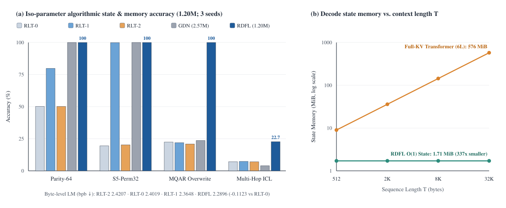

# Recursive Depth Flash Loop (`RDFL`)

**Ağırlık-Paylaşımlı Özyinelemeli Derinlik, FP32 Parça-Sınırı Belleği, Kopuk Spekülatif Başlıklar ve Doğrulayıcı-Kapılı Öz-Gelişim İçeren Bayt Düzeyi Sabit-Bellekli Hibrit Mimari**

[](LICENSE)
[](pyproject.toml)
[-1D6B5E.svg)](benchmarks/verify_audited_results.py)

**[English](README.md)** · **[Türkçe](README.tr.md)** · **[Mimari Belirtim](docs/ARCHITECTURE.md)** · **[Denetlenmiş Özet JSON](results/audited_summary.json)** · **[Ham Denetim JSON'ları](results/raw/)**

---

## Özet

Standart otoregresif Transformer mimarilerinde anahtar–değer (KV) önbelleği dizi uzunluğuyla doğrusal $O(T)$ büyür; pencereli dikkat ise belleği sınırlamak uğruna pencere ufku $M$ ötesindeki durumu kaybeder. Saf doğrusal özyinelemeli modellerde ise seçici üzerine yazma (`MQAR`) ve negatif özdeğer gerektiren durum geçişleri (`Parity`, permütasyon grupları) zayıflar.

**Recursive Depth Flash Loop (`RDFL`)**, tokenizer kullanmayan bayt düzeyi ($x_t \in \{0,\dots,255\}$) bir hibrit dizi mimarisidir; nedensel bir giriş gövdesini sabit boyutlu $O(1)$ durumlar üzerinde çalışan ağırlık-paylaşımlı bir özyinelemeli iyileştirme çekirdeğiyle birleştirir:

1. **Ağırlık-Paylaşımlı Özyinelemeli Derinlik (Opsiyonel Giriş Çıpalı):** Paylaşımlı özyinelemeli blok $R$ kez yinelenir ($h_t^{(r-1)} + \alpha_r e_t + e_r$). Kontrollü `1,20M` ablasyonları (Bölüm 2), `RDFL`'nin çekirdek kazanımının giriş çıpalamasından tek başına değil **`GatedDeltaNet + BDH + RLT-2` sinerjisinden** geldiğini göstermektedir (çıpasız `A6_R4_cipasiz`, `Multi-Hop ICL`'de eşdeğer ve `Byte LM`'de hafifçe daha iyidir).
2. **Householder Yazma Kapılı Parça-Paralel `Gated DeltaNet`:** Nedensel kısa konvolüsyon ($k=4$), çok-ölçekli yavaş sönümleme ($\alpha_0 \in [0{,}953, 0{,}999]$) ve $\beta_t = 2\sigma(\cdot) \in (0, 2)$ yazma kapısını birleştirir; dizi uzunluğundan bağımsız $S_t^{(r)} \in \mathbb{R}^{H \times d_h \times d_h}$ matris durumu taşır (`FP64`'te parça-paralel `forward == step` farkı `4,44e-16`).
3. **`BDH` Seyrek Etkileşim Kapısı ve Parça-Sınırı `FP32 SlotCore`:** İkili-seyrek ReLU etkileşimini parça sınırlarında kesin `float32` kilitli $S=4$ bellek bankasıyla eşleştirerek karma-hassasiyet taşmalarını giderir (`0/36` NaN; eş-parametre `Byte LM` ödünleşimi ve mekanistik simetrik çöküş bulgusu için bkz. Bölüm 3.1).
4. **Sıfır-Başlangıçlı Kalıntı Uyarlama ve Kayıpsız Yardımcı Başlıklar:** $W_{\uparrow}|_0 = 0$ çıkışı mevcut önceden eğitilmiş gövdelere adım-0'da `0,0` farkla bağlanır; kayıpsız spekülatif çözümleme (`K3` ve `MTP-4`, [`rdfl/speculative.py`](rdfl/speculative.py)), sıfır-parametreli kalibre belirsizlik (`MSP + T*`), sıfır-kalıntılı halka akış tamponu ve doğrulayıcı-kapılı sınırlı öz-gelişim (`AZR` RSI) ile bütünleşir.

---

## 1. Mimari


*Şekil 1: `RDFL` hesaplama grafiği (aşağıdan yukarıya). Mavi yol nedensel giriş gövdesini ve dar projeksiyonu; kehribar yol ağırlık-paylaşımlı özyinelemeli derinlik döngüsünü ve parça-sınırı `FP32 SlotCore` geri beslemesini; camgöbeği bloklar sabit $O(1)$ `Gated DeltaNet` matris durumlarını ve kopuk yardımcı tahmin başlıklarını (`K3`, `MTP-4`) gösterir. Tüm denklemler ve `RDFLModel` / `ZeroDiffRDFLAdapter` farkları [docs/ARCHITECTURE.md](docs/ARCHITECTURE.md) içindedir.*

---

## 2. Eş-Parametre `1,20M` Kıyaslamalar (`204` Kontrollü Koşu)

Tüm `1,20M` mimari kıyaslamalar 3 bağımsız tohumda yürütülmüş ve [`results/raw/ablasyon_sonuclari.json`](results/raw/ablasyon_sonuclari.json) üzerinden doğrulanmıştır (donmuş kod özeti `ab9e7db6220038a6`; `186` çekirdek/ablasyon koşusunda `0` NaN; korumasız FP16 `A6_SLOT4_MESAJLI` kolunda görülen `2` FP16 NaN koşusu Bölüm 3'teki `FP32 SlotCore` tasarımını doğrudan tetiklemiştir).



Tüm 8 kol (`ortalama ± örneklem std`, 3 tohum; algoritmik sütunlar kuyruk / üzerine yazma / 3-atlama tanılama metrikleridir: `kuyruk_48_63_acc`, `kuyruk_24_31_acc`, `uzerine_yazilan_acc`, `3hop_acc`):

| Kol | Model Ailesi | Parametre | `Parity-64` kuyruk (%) | `S5-Perm32` kuyruk (%) | `MQAR Overwrite` (%) | `Multi-Hop ICL` 3-hop (%) | Bayt LM (`bpb` ↓) |
| :--- | :--- | :---: | :---: | :---: | :---: | :---: | :---: |
| `A0` | `RLT-0` (Geri-Beslemesiz) | `1,20M` | `50,18 ± 0,37` | `19,45 ± 0,65` | `22,40 ± 1,28` | `7,13 ± 0,88` | `2,4019 ± 0,0065` |
| `A1` | `RLT-1` (Token-Adımı) | `1,20M` | `79,78 ± 26,25` | `99,93 ± 0,12` | `21,96 ± 1,32` | `7,32 ± 0,49` | `2,3648 ± 0,0174` |
| `A2` | `RLT-2` (Parça Sınırı) | `1,20M` | `50,15 ± 0,43` | `20,27 ± 1,86` | `20,92 ± 1,31` | `7,03 ± 0,29` | `2,4207 ± 0,0217` |
| `A3` | `Flash Hebbian` (Ham) | `1,20M` | `64,68 ± 23,05` | `92,75 ± 3,73` | `3,21 ± 0,48` | `5,63 ± 2,48` | `2,3504 ± 0,0028` |
| `A4` | `GatedDeltaNet` (Eş-Param) | `1,20M` | `100,00 ± 0,00` | `73,13 ± 3,54` | `19,27 ± 7,73` | `6,12 ± 3,03` | `2,2786 ± 0,0050` |
| `A4B` | `GatedDeltaNet` (Eş-FLOP) | `2,57M` | `100,00 ± 0,00` | `95,17 ± 3,93` | `23,63 ± 1,31` | `3,97 ± 0,50` | **`2,1893 ± 0,0064`** |
| `A5` | `BDH-CQ Loop` | `1,20M` | `49,88 ± 0,40` | `72,09 ± 5,39` | `3,36 ± 0,23` | `3,29 ± 0,39` | `2,4676 ± 0,0041` |
| **`A6`** | **`RDFL` (`Delta+BDH+RLT2`)** | **`1,20M`** | **`100,00 ± 0,00`** | **`100,00 ± 0,00`** | **`100,00 ± 0,00`** | **`22,72 ± 1,30`** | `2,2896 ± 0,0060` |

- **Durum Belleği Ölçeklenmesi (`L=6, d=768, H=8`, `d_h=96`):** Ölçülen $T \in \{512,\, 4{,}096,\, 32{,}768\}$ bağlam uzunluklarında FP16 Tam-KV Transformer önbelleği `9,0 / 72,0 / 576,0 MiB` doğrusal büyürken `GatedDeltaNet` sabit **`1,7139 MiB`** (`1,71 MiB` ölçülen; $T=32{,}768$'de kesin **`336,1×`** küçülme) taşır (`python benchmarks/profile_decode_memory.py` ile CPU'da yeniden üretilebilir). `55M` eğitim bağlamı $T=8{,}192$'de `RLT-2` `3.072 MiB` tavanında OOM olurken `RDFL (R=2)` `1.877,4 MiB`'de eğitilir.
- **Yapısal ve Giriş Çıpalama Ablasyonları (`dongu_cipa_rlt2_ablasyonu`):**
  - *Parça-Sınırı (`RLT-2`):* Kaldırıldığında (`A6_R4_rlt2siz`) `Multi-Hop ICL` `%22,72 ± 1,30 → %10,32 ± 11,20` (`-12,40 puan`, `8,6×` yüksek std) düşer.
  - *Döngü Derinliği (`R`):* `A6_R2_cipali` (`%23,28 ± 0,92`, `2,2903 bpb`), `A6_R4_cipali`'yi `1,8×` yüksek verimle (`34,43` vs `19,00 KB/sn`) yakalar.
  - *Giriş Çıpalama (`cipali` vs `cipasiz` — Dürüst Sıfır-Etki Bulgusu):* `A6_R4_cipasiz` (`%22,69 ± 1,76`, `2,2843 ± 0,0065 bpb`), `A6_R4_cipali` ile (`%22,72 ± 1,30`, `2,2896 ± 0,0060 bpb`) `Multi-Hop`'ta eşdeğer, `Byte LM`'de hafifçe daha iyidir; `A5_R4_cipasiz` de her iki metrikte (`%3,71` vs `%3,29`; `2,4379` vs `2,4676 bpb`) `A5_R4_cipali`'yi geçer. Çekirdek kazanım giriş çıpalamasından değil **`GatedDeltaNet + BDH + RLT-2` sinerjisinden** gelmektedir.

---

## 3. Denetlenmiş Öz-Yetenekler (`ÖY-1 .. ÖY-10` Tam Kapsam Şeffaflığı)

`ÖY-1 .. ÖY-8`, kalibrasyon tohumundan (`401`) ayrık görülmeyen tohumlarda `(42, 137, 2026)` yürütülmüştür (kod özeti `c8c2744cd90baca1`; `0` FP16 NaN; tepe `1.705,7 MiB` VRAM). `ÖY-9` ve `ÖY-10` durumları abartısız biçimde tabloda açıkça belirtilmiştir:


| No & Mekanizma | Karar / Durum | Denetlenmiş Ampirik Bulgular (`results/raw/*.json`) |
| :--- | :---: | :--- |
| **`ÖY-1/1B`: `K3` Kopuk Erken Çıkış & Spekülatif Çözümleme** | **Kabul** | Kopuk `R=1` başlığı `R=1` LM'yi `-0,3899 bpb` (`2,8886 → 2,4987`) iyileştirir (`R=4` vergisi `+0,0041 bpb`). `288/288` istemde **`0` bayt fark**, `1,48×–1,54×` geri-alma düzeltmeli FLOP tasarrufu (`1,09×` `K3/K2`, `0,991×` `K3/K4`, `1,28×` `K1/K4` duvar-saati). |
| **`ÖY-2`: Durumlu Uyarlamalı Derinlik** | **Koşullu** | Parça (`B=32`) erken çıkış `byte_lm`'de `%25,69` FLOP tasarrufuna karşılık `+0,0444 bpb / -0,94 puan`, `graf_izli`'de `%36,38` FLOP tasarrufuna karşılık `+0,0662 bpb / +0,23 puan` verir; pratikte kayıpsız `K3` spekülatif çözümleme tercih edilir. |
| **`ÖY-3`: Kalibre `MSP + T*` Belirsizlik** | **Kabul** | Sıfır ek parametre: `1,2M` `AUROC = 0,8424`, `ECE15 = 0,0116`, `%40` çekinmede `+20,13 puan` (`%52,68 → %72,81`), `8,32×` düşük graf ECE; `55M`'de **`AUROC = 0,8994 / 0,9041`** (`%74,65 → %95,35` SFT doğruluğu). |
| **`ÖY-4`: `MTP-4` Çok-Baytlı İleri Bakış** | **Kabul (`55M+`)** | **`46×` ölçek geçişi:** `1,20M`'deki `+0,0323 bpb` LM (`+0,0272` `rsi_L34`) vergisi, açık `55M` yayılımında **`32×`** eriyerek `+0,0010 bpb` LM ve `-0,0005 bpb` SFT'ye iner (eğitilmemiş adım-0 duvar-saati `0,501×`). |
| **`ÖY-5`: İstemden Öz-Düzeltme & MLP Doğrulayıcı** | **Ret** | Simetrik `T=0,0` testinde istem revizyonu eşit adımlı `D0` taslaklarını bozdu (`%87,37 → %48,44 / %49,22`). Sıfır-parametreli `log p` (`AUROC = 0,9513`), 25K MLP doğrulayıcıyı (`0,5867`) açık ara geçti. |
| **`ÖY-6`: `FP32 SlotCore` Parça-Sınırı Belleği** | **Kabul (Şerhli 3.1)** | `0/36` NaN; `graf_izli` `%68,09 ± 54,73 → %96,89 ± 1,47` (`37,3×` düşük std), `MQAR %99,88`. **Şerhler:** eş-parametre `Byte LM`'de `+0,0173 bpb` vergi (`2,3819` vs `2,3646`) ve canlı simetrik yuva çöküşü (Bölüm 3.1). `BDH`, `BDH`'siz koldan `3/3` tohumda iyi (`-0,0071 bpb`). |
| **`ÖY-7`: Doğrulayıcı-Kapılı Sınırlı `AZR` RSI** | **Kabul (Sınırlı)** | `75` nesilde hakemsiz kör `RSI1` çöktü (`LM: 7,5162 bpb`, `ID: %63,54`). Dış deterministik hakem + kalıcı `Tur 0` ID çıpası + `%30` LM tekrarı + kesin 3B ters KL + geri-alma ile en iyi **`LM = 2,9301 bpb`**, `0` geri-alma, `ID = %98,44` ve en yüksek `IPT = %80,45` (Oracle `%71,26`, Kontrol `%66,59`). |
| **`ÖY-8`: Sıfır-Kalıntılı Halka Akış Tamponu** | **Kabul** | Makbuz-kilitli halka tampon `32,0 MiB` akışta `4,0 MiB` tepe, `0,0 MiB` son disk ve `0,0 MiB` VRAM ile çalışır. |
| **`ÖY-9`: Çevrimiçi Ağırlık Öz-Düzenleme (`SEAL` / `E-SELF`)** | **Ertelendi (Kapsam Dışı)** | Yalnızca literatür incelemesinde değerlendirildi; V2 deney matrisinden ertelendi (bağımsız deney iddiası yoktur). |
| **`ÖY-10`: `ToolRunner` (`<calc>` / `<check>` / `<note>`)** | **Yalnız Eğitim-Öncesi Taban** | Kod harici eğitim deposundadır (bu pakette yer almaz). `results/raw/taban_55m_degerlendirme.json` içindeki tek ölçüm eğitim-öncesi `55M` tabanıdır (`24` soru: `%0,0` çağrı, `%0,0` doğruluk). Eğitim-sonrası `55M` ölçümü `42K` koşusu bitince eklenecektir. |

### 3.1 `graf_izli` Tohum Kırılımı, Eş-Parametre `Byte LM` Vergisi ve Mekanistik Çöküş Bulgusu

Görülmeyen tohumlarda `(42, 137, 2026)` `graf_izli` ve `Byte LM` ([`results/raw/oy5_6_sonuclari.json`](results/raw/oy5_6_sonuclari.json)):

| Kol (`ÖY-6`, `1,20M`) | `graf_izli` Tohumlar `(42 / 137 / 2026)` | `graf_izli` Ort ± Std | Bayt LM (`bpb` ↓) |
| :--- | :---: | :---: | :---: |
| `OY6_A6_TABAN` (`ffn=512`, Tek Vektör) | `%99,60 / %99,77 / %4,89` | `%68,09 ± 54,73` | `2,3646 ± 0,0017` |
| `OY6_A6_BDHSIZ` (`ffn=896`, BDH'siz) | `%5,97 / %99,34 / %99,92` | `%68,41 ± 54,08` | `2,3717 ± 0,0030` |
| `OY6_A6_SASKINLIK_GDN` (`Titans-A`) | `%99,61 / %59,72 / %85,06` | `%81,46 ± 20,19` | **`2,3641 ± 0,0015`** |
| **`OY6_A6_SLOT4_FP32` (`ffn=128`, `FP32 SlotCore`)** | **`%95,30 / %98,19 / %97,17`** | **`%96,89 ± 1,47`** | `2,3819 ± 0,0055` (`+0,0173`) |

- **Eş-Parametre `Byte LM` Gerilemesi (`+0,0173 bpb`):** `1,20M` eş-parametre bütçesinde `FP32 SlotCore` eklemek için `ffn` boyutunun `512 → 128` daraltılması `Byte LM`'de `+0,0173 bpb` vergiye yol açmıştır (`2,3819` vs `2,3646`). `55M` ölçeğinde bu vergiyi önlemek için `SlotCore` daraltılmamış `ffn=3072` omurga dışına eklenir.
- **Mekanistik Dürüstlük Bulgusu (`FP32 SlotCore` Simetrik Çöküş — [`results/raw/slotcore_55m_cosine_probe.json`](results/raw/slotcore_55m_cosine_probe.json)):** Canlı eğitilmiş `55M` checkpoint'te (adım `21.000`, `16` gerçek parça / `1.024` bayt `mix/validation.bin`, CPU ölçümü): `init_slots` kosinüs benzerliği **`0,5017–0,7512`** (`ort = 0,6446`, `norm = 0,6941`) iken `16` parça sonunda tüm $S=4$ yuva arasındaki kosinüs **`0,999982`** (`min = 0,999959`, `maks = 0,999999`) ve ortalama norm **`664,5`** (adım `17.500`'deki `~577` değerinden büyümeye devam ederek) olmaktadır. CPU'da `python benchmarks/run_1_2m_suite.py --smoke --measure-slot-cosine` ile 8 parça sonrası `cos ≈ 0,988` çöküşü doğrudan gözlenir. Dolayısıyla kazanç "4 ayrı uzmanlaşmış yuva"dan değil, **parça sınırındaki birikimli `FP32` kalıntı durumdan** gelmektedir. **`v0.3`** için rekabetçi yuva-eksenli `SlotAttention` + yuva-başı `RMSNorm` ve sönümleme planlanmıştır.

---

## 4. `55M` Sıcak Uyarlama, Değerlendirme Ayrımı ve Kontrol Kapsamı

- **`1.500`-Adımlık `G0` / `G1` Kapısı (`saat1_mtp_kapisi.json`) & Canlı Anlık Görüntü (`diogenes_55m_live_val_snapshot.json`):**
  - *Hızlı Doğrulama (`fast-val`: `4` yığın, `200` SFT satırı):* Adım-0 taban `1,1268 / 1,0419 / 1,2416` (`MTP t+2/3/4 = %10,1 / %9,2 / %10,7`); `G0` ($\lambda_{\text{MTP}} = 0$, 1.5K): `1,1232 / 1,0344 / 1,2415`; `G1` ($\lambda_{\text{MTP}} = 0,15$, 1.5K): `1,1242 (+0,0010) / 1,0362 / 1,2410 (-0,0005)`, `MTP = %34,1 / %24,6 / %21,4`. Ön canlı gözlemler: `7K` adım `1,1207 / 1,0277 / %51,6 t+2`; `17,5K` adım `1,1188 / 1,0278 / %54,2 t+2`; `21K` adım `1,1197 / 1,0254 / %54,9 t+2`.
  - *Tam Batarya (`full-val`: `8` yığın, `400` SFT satırı, `taban_55m_degerlendirme.json`):* Adım-0 taban `1,1549 / 1,0718 / 1,2567` (aynı dosyadaki `oy6_slotcore_ablasyon` ise `fast-val` `4` yığınla `1,0419` ölçer).
  - *Kontrol Kapsamı:* `G0/G1` kapısı **`MTP-4`'ü izole eder** (her iki kolda da `RDFL` açıktır). `RDFL`'siz düz devam-eğitim kontrolü (**`G_BASE_ONLY`, `1.500` adım**) devam eden `42K` ana koşu biter bitmez çalıştırılıp tam `55M` eğitim-sonrası bataryasıyla (`ToolRunner`, `cmem`, gerçek QA, `AZR` RSI) yayımlanacaktır.

---

## 5. Yöntemsel Kısıtlar

1. **Referans Çekirdek:** Mevcut sonuçlar saf PyTorch parça-paralel WY + SDPA ile üretilmiştir; sıfırdan büyük ölçekli (`200M+`) eğitim için Triton / Flash Linear Attention birleştirmesi gerekir.
2. **Yuva Simetrik Çöküşü ve Eş-Parametre LM Vergisi (`v0.2`):** `Fp32SlotCoreBoundary` uzun akışta yuvaları `cos = 0,99998` / `norm = 664,5` düzeyine çökertir ve `1,20M` eş-parametre koşulunda `+0,0173 bpb` LM vergisi öder (`v0.3`'te rekabetçi `SlotAttention` + sönümleme planlanmıştır).
3. **Giriş Çıpalaması (`1,20M` Sıfır Etki):** Çıpasız `A6_R4_cipasiz`, `Multi-Hop`'ta çıpalı kola eşit ve `Byte LM`'de hafifçe daha iyidir.
4. **Uzak-OOD ve Bekleyen `55M` Ölçümleri:** `1,20M` RSI deneylerinde `OOD-Uzak` (`L=7,8`) tüm kollarda `%0,0` kalmıştır; `55M` eğitim-sonrası `ToolRunner` (`ÖY-10`) ve `G_BASE_ONLY` sonuçları devam eden `42K` koşunun tamamlanmasını beklemektedir.

---

## 6. Hızlı Başlangıç ve Tek-Komutla Doğrulama (CPU)

```bash
git clone https://github.com/berkmec/Recursive-Depth-Flash-Loop.git
cd Recursive-Depth-Flash-Loop
pip install -e ".[dev]"
python -m unittest discover -s tests -v
python benchmarks/verify_audited_results.py
python benchmarks/profile_decode_memory.py
python benchmarks/run_1_2m_suite.py --smoke
python scripts/build_diagrams.py
```

```python
import torch
from rdfl import (
    RDFLConfig,
    RDFLModel,
    ZeroDiffRDFLAdapter,
    greedy_decode,
    msp_uncertainty,
    speculative_decode_k3,
    speculative_decode_mtp4,
)

cfg = RDFLConfig(d_model=192, num_heads=6, ffn_dim=512, num_loops=2, num_slots=4)
model = RDFLModel(cfg).double().eval()
prompt = torch.randint(0, 256, (1, 32))

# K3 ve MTP-4 ile 0-bayt-farklı kayıpsız spekülatif çözümleme
ref = greedy_decode(model, prompt, max_new_tokens=16)
res_k3 = speculative_decode_k3(model, prompt, max_new_tokens=16, draft_k=2)
res_mtp = speculative_decode_mtp4(model, prompt, max_new_tokens=16)
assert (res_k3.tokens == ref).all() and (res_mtp.tokens == ref).all()

# Sıfır-parametreli MSP belirsizlik ve adım-0 sıfır-farklı omurga adaptörü
logits, _, _, _ = model.forward_stateful(prompt)
conf, unc = msp_uncertainty(logits)
adapter = ZeroDiffRDFLAdapter(d_base=1536, d_narrow=384, num_heads=6, num_loops=2)
z_base = torch.randn(1, 32, 1536)
assert (adapter(z_base) - z_base).abs().max().item() == 0.0
```
