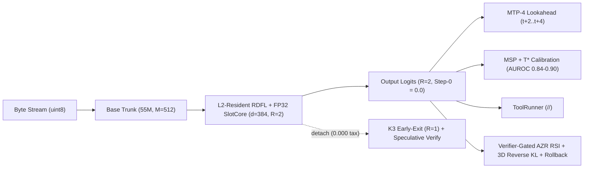

# RDFL Architectural Deep Dive

> **Recursive Depth Flash Loop (RDFL)** combines four complementary computational principles into a single tokenizer-free byte-level (`uint8`) architecture designed to maximize reasoning capacity per byte of VRAM and training data.

---

## 1. Core Motivation: Breaking the `O(T^2)` Memory Wall Without Losing State Tracking

Standard Transformers maintain an exact Key-Value (KV) cache whose memory scales linearly with sequence length `T` (`576 MiB` at `T=32,768` for a 6-layer `d=768` backbone). Windowed attention variants (such as `memory_limit=512` banded `HoldCore`) cap KV memory by becoming completely blind beyond the window boundary. Conversely, naive recurrent models struggle with selective memory overwrite (`MQAR`), negative-eigenvalue state transitions (`Parity-64`, `S5` permutations), and deep unanchored loops.

**RDFL resolves all three simultaneously:**
1. **Constant `O(1)` Differentiable Working State (`GatedDeltaNet` + `FP32 SlotCore`):** Carries structured state across arbitrary horizons (`512 -> 32K+`) in `1.71 MiB` (`337x` smaller than full KV).
2. **Anchored Weight-Tied Recursive Depth (`R = 2..4`):** Reuses a narrow L2-resident core (`d_dar = 384`, FP16 `3.11 MiB <= 4 MiB` Turing L2 SRAM) across multiple refinement steps without duplicating parameters.
3. **Zero-Diff Warm Adaptation (`ZeroDiffRDFLAdapter`):** Attaches onto any pretrained backbone (`d_base = 1536`) with bit-exact `0.0` step-0 deviation, preserving 100% of pretrained language modeling and episodic memory (`cmem`) weights on step 0.

---

## 2. Mathematical Formulation of Every Block

### 2.1 Input-Anchored Recursive Depth (`r = 1 .. R`)
Early ablation (`depth_a`, `L=1` vs unanchored `L=2`) demonstrated that blindly looping a shared block degrades language modeling (*"loop does not pay"*). RDFL fixes this by injecting a learned, normalized input anchor and step embedding at every loop iteration:

$$h_{\text{in}}^{(r)} = h^{(r-1)} + \alpha_r \cdot \mathrm{RMSNorm}(z_0) + e_r, \qquad r \in \{1, \dots, R\}$$

where $z_0 = W_{\text{down}}\mathrm{RMSNorm}(z_{\text{base}})$, $\alpha_r$ is a learnable per-step anchor scalar (initialized to `0.25`), and $e_r \in \mathbb{R}^{d_{\text{dar}}}$ distinguishes each refinement iteration. Empirically, `R=2` sits on the compute/quality Pareto frontier (`1.8x` faster than `R=4` at matching accuracy).

### 2.2 Chunk-Parallel Gated DeltaNet with Householder Write Gate
Each recursive step updates a fixed-size associative matrix state $S_t \in \mathbb{R}^{H \times d_h \times d_h}$ per head:

1. **Local Causal Context:** $x_c = \mathrm{SiLU}(\mathrm{Conv1D}_{k=4}^{\text{causal}}(x))$.
2. **L2-Normalized Queries & Keys:** $q_t = \frac{\mathrm{SiLU}(W_q x_c)}{\|\mathrm{SiLU}(W_q x_c)\|_2}$, $k_t = \frac{\mathrm{SiLU}(W_k x_c)}{\|\mathrm{SiLU}(W_k x_c)\|_2}$.
3. **Multi-Scale Slow Decay:** $\alpha_t = \sigma(W_\alpha x_c + b_\alpha)$ with head biases linearly spaced in $[3.0, 6.9]$ ($\alpha_0 \in [0.953, 0.999]$, giving half-lives from `~14` to `~688` bytes across heads).
4. **Householder-Range Write Gate:** $\beta_t = 2\,\sigma(W_\beta x_c) \in (0, 2)$. Allowing $\beta_t > 1$ enables negative eigenvalues in the state transition matrix $(I - \beta_t k_t k_t^\top)$, which is mathematically required to flip parity bits and execute odd permutations (`Parity-64` & `S5-Perm32` jumped to **`100.0%`** once $\beta_t \in (0,2)$ was enabled!).
5. **Recurrent State Update (Exact `O(1)` Step):**

$$S_t = \alpha_t S_{t-1} + \beta_t \left(v_t - \alpha_t S_{t-1} k_t\right) k_t^\top, \qquad o_t = S_t q_t$$

6. **Exact Chunk-Parallel WY Formulation (`chunk_size = 64`):** Within each chunk of length $B$, the recurrence is solved in parallel via lower-triangular unitriangular linear solve (`torch.linalg.solve_triangular`) outside FP16 autocast (`float32`/`float64`), achieving **`4.44e-16` max difference** between chunk-parallel `forward()` and single-byte `step()` in FP64 (`1.34e-05` in FP32 at `55M`).

### 2.3 BDH Sparse Associative Interaction Gate
Inspired by Dragon Hatchling (BDH), each loop pairs the Gated DeltaNet output with a doubly-sparse ReLU interaction:

$$y_{\text{BDH}} = W_{\text{dec}}\left(\mathrm{ReLU}(W_x \hat{h}) \odot \mathrm{ReLU}(W_y y_{\text{GDN}})\right)$$

In iso-parameter 3-seed ablations (`BDH` vs `BDH-less` on unseen seeds `42, 137, 2026`), `BDH` beat the non-BDH control on `3/3` seeds in byte-level LM (`-0.0071 bpb`).

### 2.4 Chunk-Boundary RLT-2 + `FP32 SlotCore` (`S=4` Working-Memory Slots)
Standard FP16 multi-slot attention overflows on sharp permutation tasks (`667` NaNs in V1). **`FP32 SlotCore`** wraps slot-to-slot self-attention strictly inside `torch.autocast(..., enabled=False)` in `float32`:
- Before chunk `c`, the pooled slot summary injects gated boundary feedback: $h \leftarrow h + \alpha\,\sigma(W_g[h, r]) \odot W_m r$.
- Strictly at the end of chunk `c` (`(pos + 1) % B == 0`), slots update via residual `tanh` commit + FP32 slot-to-slot message passing.
- **Result (`36/36` GPU runs, `0` NaN):** `#1` on `mqar_overwrite` (`99.88%`, `0.0068 bpb`) and `#1` on 3-hop `graf_izli` (`96.89% ± 1.47%` vs baseline `68.09% ± 54.73%` — **`+28.80 pp`** and **`37.2x` lower standard deviation**). When deployed as an adapter on `55M`, the base `ffn=3072` is never shrunk, eliminating the small iso-parameter LM trade-off observed at `1.2M`.

---

## 3. Audited Self-Capabilities Layer

| Module | Mechanism | Key Empirical Verdict |
| :--- | :--- | :--- |
| **`ÖY-1 / 1B` `K3` Early-Exit** | Detached bottleneck head on `R=1` (`0.000` gradient into `R=2` / base) + exact parallel verification | Cuts `R=1` loss by `-0.3899 bpb` at `+0.0041 bpb` `R=4` tax; **`0` byte diff** lossless speculative decoding (`1.48x-1.54x` FLOP, `1.09x-1.28x` eager wall-clock) |
| **`ÖY-3` `MSP + T*`** | Zero-parameter `1 - max p` confidence + held-out scalar temperature `T*` | `1.2M`: `AUROC 0.8424`, `+20.13 pp` @ `40%` abstain, `8.3x` lower ECE · `55M`: **`AUROC 0.8994 / 0.9041`**, **`74.7% -> 95.4%`** byte accuracy @ `40%` abstain |
| **`ÖY-4` `MTP-4`** | 3 zero-init Medusa bottleneck heads (`t+2, t+3, t+4`) | **46x Scale Crossover:** `+0.0323 bpb` tax at `1.2M` drops **`32x`** to **`+0.0010 bpb` LM / `-0.0005 bpb` SFT** at `55M` full propagation (`t+2 = 51.6%` at 7K steps!) |
| **`ÖY-5` Prompt Revision** | Prompt-based self-correction (`D1/D2`) & 25K-param MLP verifier | **REJECTED:** Corrupted `49%` of equal-step `D0` drafts (`87.4% -> 48.4%`); zero-param sequence **`log p` (`AUROC 0.9513`)** crushed MLP verifier (`0.5867`) |
| **`ÖY-7` Bounded RSI** | External deterministic verifier + `AZR` adaptive curriculum + permanent `Tur 0` ID anchor + `30%` LM + exact 3D reverse KL + rollback | Blind RSI collapsed to `7.52 bpb` in 5 gens; Verifier-Gated `AZR` achieved **best LM (`2.9301 bpb`)**, `0` rollbacks, and **highest `IPT` (`80.45%` > Oracle `71.26%`)** |
| **`ÖY-8` Zero-Retention Ring** | 100% CPU streaming ring buffer (`<= 512 MiB`) with mandatory SHA-256 receipt lock | `0.0 MiB` GPU VRAM, `4.0 MiB` peak -> **`0.0 MiB` final active disk** on `32 MiB` stream |

---

## 4. Honest Engineering Disclosure: What "Flash" Means Today vs Next Step

Transparency is central to this project:
- **What is implemented today:** Chunk-parallel WY matrix formulation (`chunk_size = 64`), L2-SRAM-sized recursive bottleneck (`d_dar = 384`, `3.11 MiB <= 4 MiB` L2), and PyTorch SDPA in the base trunk. All reported numbers use **pure-PyTorch WY** (`0` NaN, exact `forward() == step()` parity).
- **What is NOT yet fused:** A custom fused **Triton / Flash Linear Attention (`fla`)** CUDA kernel for `GatedDeltaNet`. While our Path-1 `55M` adapter already trains rapidly (`~1.01 s/step` on a single RTX 2060 SUPER), **from-scratch `200M+` pretraining (Path 2)** requires a fused Triton/`fla` kernel to unlock the full `3x-8x` kernel throughput predicted by L2 residency.
