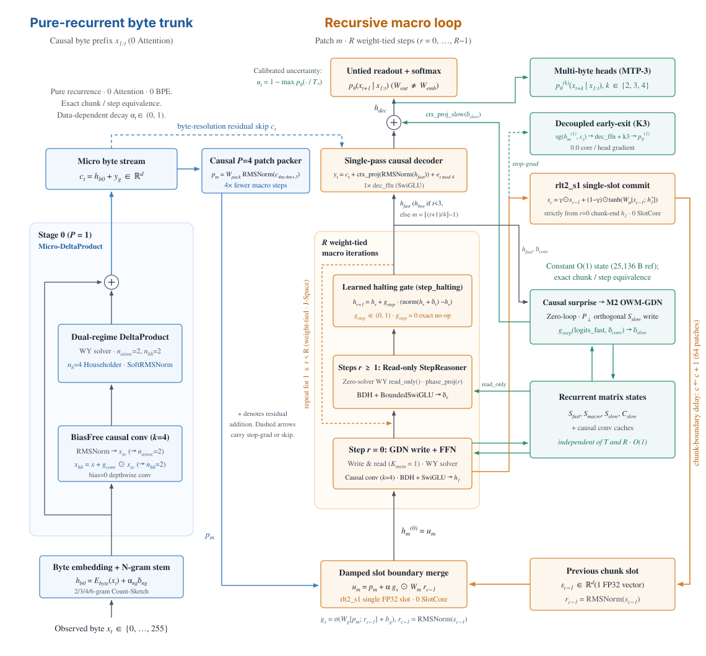

# Architectural Specification: Recursive Depth Flash Loop (`RDFL`)

---

## 1. Problem Statement and Design Principles

Autoregressive sequence models face a structural trade-off between **context horizon**, **memory complexity**, and **algorithmic state tracking**:

- **Full Self-Attention** provides exact random access over $x_{1:t}$ at the cost of $O(T)$ decode memory (`576 MiB` at $T = 32{,}768$ for a 6-layer $d=768$ backbone).
- **Windowed Attention** bounds cache size to $O(M)$ but drops all state beyond window length $M$.
- **Unanchored Weight-Tied Recurrence** reuses parameters across depth iterations $r = 1,\dots,R$, yet suffers from optimization drift when hidden states are not re-anchored to the input representation.

**`RDFL`** resolves this trade-off through four mutually reinforcing mechanisms: (i) input-anchored weight-tied depth, (ii) chunk-parallel Gated DeltaNet with Householder-range write gates, (iii) doubly-sparse associative gating (`BDH`), and (iv) chunk-boundary `FP32 SlotCore` working memory.

---

## 2. Exact Mathematical Formulation

### 2.1 Causal Input Trunk and Narrow Projection
Given a raw byte prefix $x_{1:t} \in \{0, \dots, 255\}^t$, a causal input trunk $E_\theta$ (either a pretrained windowed-attention backbone of width $d_{\text{base}}$ or a standalone embedding stem) produces $z_t^{\text{base}} = E_\theta(x_{1:t})$. A narrow bottleneck projection maps this stream into the recursive latent dimension $d$:

$$z_t^0 = W_{\downarrow}\,\mathrm{RMSNorm}(z_t^{\text{base}}) \in \mathbb{R}^d, \qquad e_t = \mathrm{RMSNorm}(z_t^0)$$

### 2.2 Chunk-Boundary `FP32 SlotCore` Feedback
The sequence is partitioned into causal chunks of length $B$ (e.g., $B = 64$). A bank of $S$ working-memory slots $M_{c-1} \in \mathbb{R}^{S \times d}$ summarizes prior chunks $1, \dots, c-1$. Before chunk $c$ enters the recursive loop, its mean-pooled summary injects gated boundary feedback:

$$r_{c-1} = \mathrm{RMSNorm}\!\left(\frac{1}{S}\sum_{s=1}^S M_{c-1,s}\right), \qquad g_t = \sigma\!\left(W_g[z_t^0;\, r_{c-1}] + b_g\right), \qquad h_t^{(0)} = z_t^0 + \alpha\, g_t \odot W_m r_{c-1}$$

Strictly at chunk boundaries $t \equiv 0 \pmod B$, the slot bank updates via residual `tanh` integration followed by off-diagonal slot-to-slot self-attention executed **strictly in `float32`** outside mixed-precision autocast (`0` FP16 NaN across `36/36` experimental runs):

$$\tilde{M}_c = M_{c-1} + 0.1\,\tanh\!\big(W_u[M_{c-1};\, \mathbf{1}_S (h_{\text{end}}^{(R)})^\top]\big), \qquad M_c = \tilde{M}_c + 0.15\,\mathrm{SlotAttn}_{\text{FP32}}(\tilde{M}_c)$$

### 2.3 Input-Anchored Weight-Tied Recursive Core ($r = 1, \dots, R$)
At each iteration $r \in \{1, \dots, R\}$, the shared core receives the previous hidden state re-anchored to $e_t$ with a learned step embedding $e_r \in \mathbb{R}^d$:

$$\tilde{h}_t^{(r)} = \mathrm{RMSNorm}\!\left(h_t^{(r-1)} + \alpha_r\, e_t + e_r\right)$$

1. **Chunk-Parallel Gated DeltaNet (`WY` Solver):** After a depthwise causal short convolution ($k=4$), L2-normalized queries/keys ($q_t, k_t$), multi-scale slow decay gates ($\alpha_t = \sigma(W_\alpha x_c + b_\alpha)$ with biases initialized across $[3.0, 6.9]$, corresponding to $\alpha_0 \in [0.953, 0.999]$), and Householder-range write gates ($\beta_t = 2\sigma(W_\beta x_c) \in (0, 2)$) update the constant-size associative matrix state $S_t^{(r)} \in \mathbb{R}^{H \times d_h \times d_h}$:

$$S_t^{(r)} = \alpha_t S_{t-1}^{(r)} + \beta_t \left(v_t - \alpha_t S_{t-1}^{(r)} k_t\right) k_t^\top, \qquad y_t^{(r)} = W_o\!\left(\mathrm{RMSNorm}(S_t^{(r)} q_t) \odot \mathrm{SiLU}(W_g \tilde{h}_t^{(r)})\right)$$

Allowing $\beta_t \in (0, 2)$ permits negative eigenvalues in $(I - \beta_t k_t k_t^\top)$, which is algebraically necessary to execute bit-flips (`Parity-64`) and odd permutations (`S5-Perm32`). Within each chunk of length $B$, the recurrence is computed in parallel via unitriangular lower-triangular solve (`WY` representation), achieving exact equivalence with single-byte `step()` execution (`4.44e-16` max difference in FP64).

2. **BDH Sparse Associative Interaction Gate:**

$$h_t^{(r)} = h_t^{(r-1)} + y_t^{(r)} + W_{\text{dec}}\!\left(\mathrm{ReLU}(W_x \tilde{h}_t^{(r)}) \odot \mathrm{ReLU}(W_y y_t^{(r)})\right)$$

### 2.4 Zero-Initialization Residual Fusion and Auxiliary Heads
After the final iteration $R$, a zero-initialized projection $W_{\uparrow}$ ($W_{\uparrow}|_0 = 0$) merges the recursive refinement back into the trunk stream:

$$\Delta z_t = W_{\uparrow}\,\mathrm{RMSNorm}(h_t^{(R)}), \qquad \hat{z}_t = \mathrm{RMSNorm}(z_t^{\text{base}} + \Delta z_t), \qquad p_\Theta(x_{t+1} \mid x_{1:t}) = \mathrm{softmax}(W_{\text{out}}\hat{z}_t)$$

Because $\Delta z_t \equiv 0$ at step 0, warm adaptation preserves `100%` of the pretrained backbone and external episodic memory (`cmem`) behavior on initialization (`0.0` exact deviation).

- **Decoupled Early-Exit (`K3`):** Applies a lightweight bottleneck adapter to $\mathrm{sg}(h_t^{(1)})$ with frozen readout weights, incurring **`0.000` gradient interference** on the main $R$-loop while supporting exact `0`-byte-mismatch parallel speculative verification.
- **Multi-Byte Lookahead (`MTP-4`):** Attaches $3$ zero-initialized residual bottlenecks to $\hat{z}_t$ predicting $x_{t+2}, x_{t+3}, x_{t+4}$, optionally propagating gradients through the full trunk (`stop_grad=False`) or training purely as speculative draft heads (`stop_grad=True`).
- **Calibrated Uncertainty (`MSP + T*`):** Uses scalar temperature scaling $T^*$ fitted on a held-out split to produce selective abstention uncertainty $u_t = 1 - \max_v p_\Theta(v \mid x_{1:t}; T^*)$ with zero additional parameters.
- **Bounded Verifier-Gated RSI:** Optimizes policy updates strictly over externally verified traces regularized by natural-language replay, a permanent `Tur 0` in-distribution anchor, a validation rollback gate, and exact per-token 3D reverse KL:

$$D_{\text{KL}}(\pi_g \,\|\, \pi_0) = \frac{1}{BT}\sum_{b=1}^B\sum_{t=1}^T \sum_{v=0}^{255} \pi_g(v \mid x_{b,<t}) \log \frac{\pi_g(v \mid x_{b,<t})}{\pi_0(v \mid x_{b,<t})}$$

---

## 3. Kernel Implementation Note

The reference PyTorch implementation executes chunk-parallel `WY` updates in exact FP32/FP64 via `torch.linalg.solve_triangular` alongside PyTorch SDPA. Fusing the chunk-parallel `GatedDeltaNet` recurrence into a Triton / Flash Linear Attention (`fla`) kernel leaves the mathematical specification unchanged while substantially accelerating large-scale from-scratch training.
